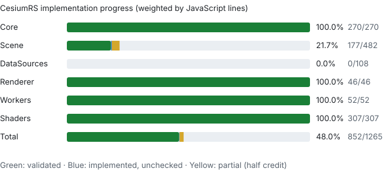
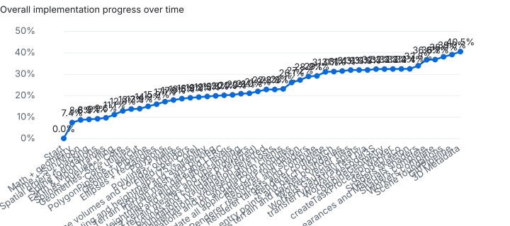

# Port tracker

Generated by `tools/cesium/tracker.mjs` from `@cesium/engine` 23.0.0 (CesiumJS 1.139) and `tools/cesium/status.json`. Do not edit by hand.

**Overall implementation: 32.4%** of 383,786 applicable JavaScript lines. Implementation progress is weighted by line count (partial = half) and leaves out modules marked n/a. **Validated coverage: 32.3%.**

- ✅ **ported**: the module's public behaviour exists in Rust and is checked against CesiumJS fixtures (`tests/fixtures`) or ported unit tests.
- 🟦 **implemented**: the Rust implementation and concrete host adapters exist; parity validation has not been run. These entries do not count as validated.
- 🟡 **partial**: some of the module is ported; the note says what is missing.
- ➖ **n/a**: a JavaScript or browser idiom with no Rust counterpart; the note says what replaces it.
- ⬜ **todo**: not started.

| Package | Modules | Validated | Implemented, unchecked | Partial | Todo | n/a | Implementation |
| --- | ---: | ---: | ---: | ---: | ---: | ---: | ---: |
| Core | 288 | 270 | 0 | 0 | 0 | 18 | 100.0% |
| Scene | 482 | 0 | 0 | 0 | 482 | 0 | 0.0% |
| DataSources | 108 | 0 | 0 | 0 | 108 | 0 | 0.0% |
| Renderer | 46 | 46 | 0 | 0 | 0 | 0 | 100.0% |
| Workers | 53 | 51 | 0 | 1 | 0 | 1 | 97.3% |
| Shaders | 307 | 0 | 0 | 0 | 307 | 0 | 0.0% |
| **Total** | 1284 | 367 | 0 | 1 | 897 | 19 | **32.4%** |

## Plan

**Core implementation: 100.0%; validated: 100.0%** of 98,177 lines. Core implementation is complete. The 100% validated Core milestone is reached.

Batches toward **100% Core**, in dependency order. Each module is ported with CesiumJS fixtures before it is marked ported. The 75% milestone is an intermediate checkpoint, not the completion target.

Along the way, `core::js_math` made the port's `sin`, `cos`, `log` and the other `Math` functions round exactly as V8's do, after a one-bit difference in `cos` moved a rectangle's bounding sphere.

1. ✅ **Small utilities:** containers, URI and query helpers, typed-array strings, `PixelFormat`, `PixelDatatype`, and Core's enums.
2. ✅ **Polygon and instance foundations:**
   - ✅ earcut 3.2.4 and `PolygonPipeline`
   - ✅ `GeometryInstance` and its Color, Show, Offset and DistanceDisplayCondition attributes
   - ✅ `GeometryPipeline`, including antimeridian splitting of triangles, lines and polylines
3. ✅ **Surface geometries:**
   - ✅ `EllipseGeometry`, `CircleGeometry`
   - ✅ `RectangleGeometry`, `RectangleGeometryLibrary`, `RectangleOutlineGeometry`
   - ✅ `PolygonGeometryLibrary`, `PolygonGeometry`, `PolygonOutlineGeometry`, and the coplanar polygon geometries
4. ✅ **Line and volume geometries:**
   - ✅ `PolylinePipeline`, `PolylineGeometry`, `SimplePolylineGeometry`
   - ✅ `WallGeometryLibrary`, `WallGeometry`, `WallOutlineGeometry`
   - ✅ `PolylineVolumeGeometryLibrary`, `PolylineVolumeGeometry`, `PolylineVolumeOutlineGeometry`
   - ✅ `CorridorGeometryLibrary`, `CorridorOutlineGeometry`
   - ✅ filled `CorridorGeometry`, including extrusion, surface frames, bounds and shadow volumes
5. ✅ **Terrain helpers:** `TerrainEncoding` and `HeightmapTessellator`, passing the 75% Core checkpoint
6. ✅ **Terrain data and picking:**
   - ✅ `TerrainProvider` contract, cached grid/edge/skirt indices and geometric errors; `TileAvailability` quadtree ranges and coverage queries
   - ✅ `TerrainPicker`, `TerrainMesh`, and native incremental picker refinement
   - ✅ `TerrainData`, `HeightmapTerrainData`, LERC decoding and native heightmap mesh processing
   - ✅ `QuantizedMeshTerrainData` and native quantized mesh creation/upsampling
   - ✅ 3D Tiles and Google Earth Enterprise terrain data/processors
7. ✅ **Remaining spatial algorithms:**
   - ✅ `S2Cell`, Hilbert levels above 32 through Cesium's finite numeric bounds, and `ApproximateTerrainHeights` with the pinned lookup table
   - ✅ `RectangleCollisionChecker`, including multi-level R-tree insertion/removal reference cases
   - ✅ `GroundPolylineGeometry`
8. ✅ **Asset and texture processing:** compressed texture buffers, portable KTX2/Basis decoding/loading, texture packing, vector/GEE decoding and concrete browser image/canvas adapters. Reference fixtures and real Chromium checks pass.
9. ✅ **Resource and execution infrastructure:** requests/errors, scheduling/statistics, resources and typed HTTP operations/retries, trusted servers, workers, proxies and sanitized credits. Reference scheduler fixtures, native HTTP/worker integration and Chromium lifecycle checks pass.
10. ✅ **Terrain providers and service clients:**
   - ✅ `EllipsoidTerrainProvider`, `CustomHeightmapTerrainProvider`
   - ✅ network heightmap/quantized and 3D Tiles terrain providers, Google Earth Enterprise metadata and terrain, world-terrain factories. Ion resources/geocoding and platform clients are now validated. Bing, Google, Pelias, OpenCage and coordinate geocoders pass deterministic parsing, request construction, attribution and error fixtures.
11. ✅ **Contracts and host behavior:** interpolation/packing interfaces, geometry factories, video bindings, terrain sampling, screen-space gestures and canvas text/pin rendering validated.

Core and Renderer have reached 100% of applicable modules; Workers completion is the active milestone, followed by Scene. Progress requires implemented behavior and reference validation; placeholder APIs do not count. Existing n/a entries describe JavaScript-specific idioms and must retain explicit Rust replacement notes. The viewer already runs on Core — it was migrated ahead of 100% Core so the two implementations could not drift apart. After Core, proceed to Renderer and Scene.

### Validated partial-module batch

All 35 formerly partial Core implementations and the native KTX2 worker calculation now pass validation. The batch adds 617 pinned CesiumJS cases, native lifecycle/HTTP checks and 23 Chromium checks, including Rust video/worker bindings and packaged WASM codec output. Validation found and fixed short GEE packet decoding, Basis codec configuration/output differences and lost ready terrain results on tile/level errors. See [validation details](docs/core-validation.md).

The final 20 Core modules are implemented and validated. This batch adds 199 pinned reference cases, native terrain/input integration and exact Chromium text/pin and gesture comparisons. Core has 270 validated applicable modules and no remaining partial or todo entries. The 18 n/a entries retain explicit Rust replacement notes. Renderer is now complete; Workers completion is the next package milestone.

### Renderer completion

All **46 Renderer modules** are implemented and reference-validated. The final
13 close Context, UniformState and AutomaticUniforms and add cube/volume textures,
face loading, atlases, vertex-array facades, shared contexts, uniform factories
and immutable render-state helpers. The browser adapter executes WebGL1 and
WebGL2, including extension dispatch and a software VAO fallback.

Validation covers **1,549 portable Renderer cases**, **1,720 Chromium assertions**
across the original and completion suites, and native lifecycle, async ordering,
cache, cancellation and failure regressions. All 90 automatic uniforms have value
providers; 83 numeric values are compared across 14 Scene frame scenarios and
all seven sampler inputs are exercised during draws. See
[Renderer API and validation](docs/renderer-foundation.md).

After Workers, port Scene using the typed frame snapshots, shared resource
ownership and executable Renderer commands. The raw viewer's migration to this
API and a concrete native GPU driver remain separate integration work; native
applications can implement the existing `Gl` host contract.

### Workers completion

Workers has **51/53 validated modules**, matching the Workers row in the package table.
Direct CesiumJS worker fixtures cover typed/packed inputs and batch/result wire
formats; geometry, terrain, vector-tile, Gaussian splat, I3S, combineGeometry, and
createTaskProcessorWorker workers are in that validated set. Ground polylines use the bundled height table. Host-registered
Rust factories replace dynamic module imports. No Scene module is marked complete
for the result-packing helpers.

`combineGeometry` is ported. It unpacks `createGeometry` results onto packed
instances, then runs the existing geometry pipeline: world transforms, optional
antimeridian splits, `batchId`, vertex-cache reorder, combine, 2D projection,
high/low encoding, compression, and unsigned-short index fitting. Bounding
spheres are packed as `Float32Array`s. Direct worker cases call the real
adapter. Shared geometry helpers are unchanged.

`createTaskProcessorWorker` is ported. It adapts a calculation to the
TaskProcessor message contract: task id, parameters, `CESIUM_BASE_URL`,
`Error` versus non-Error failures, clearing the transfer list when
`canTransferArrayBuffer` is false, and the `postMessage` / `onmessageerror`
failure strings produced by `formatError`. Direct worker cases call the real
adapter. `TaskProcessor` itself is unchanged and still moves owned buffers.
Object keys in those failure strings follow `JSON.stringify`: array indexes
first, in ascending order, then every other key in insertion order.

`transferTypedArrayTest` is n/a. It is a Web Worker `onmessage` handler that
posts the received typed array back by transferring `array.buffer`, or posts an
empty object if that transfer throws. It performs no calculation. Rust workers
return owned buffers, and `TaskProcessor` moves those values instead of
transferring `ArrayBuffer`s.

`decodeDraco` is partial. Dequantized triangular-mesh and point-cloud payloads,
including non-float and 64-bit attributes, the geometry-type errors, and the
WebAssembly initialization message (`true`; there is no module to compile)
match the CesiumJS worker on direct cases. Model's Draco loader turns
`dequantizeInShader` on by default, so the most common production path differs
from CesiumJS. `draco-core` 2.3.2 always inverse-transforms and drops the
portable integers and quantization parameters that `SkipAttributeTransform`
keeps, and it exposes no skip API. Mesh decode, face indices, and the
mapped-index attribute walk live in `workers::draco`, which `decodeI3S` also
uses. There is no remaining todo worker module. See
[Workers details](docs/workers.md).

## Core

| Module | Lines | Status | Rust | Note |
| --- | ---: | --- | --- | --- |
| ApproximateTerrainHeights | 256 | ✅ ported | `core::approximate_terrain_heights` | Bundled pinned Cesium height table or caller-supplied JSON; initialized state, cached loading, curvature-adjusted min/max and bounding spheres. Owned/thread-safe scratch state preserves out-of-scheme coordinate behavior; 268 reference cases. |
| ArcGISTiledElevationTerrainProvider | 756 | ✅ ported | `core::arcgis_tiled_elevation_terrain_provider` | EPSG metadata, LERC heightmaps, shared tilemap availability, tile requests and child masks; metadata fixtures and request contracts. |
| ArcType | 32 | ✅ ported | `core::arc_type` |  |
| ArticulationStageType | 24 | ✅ ported | `core::articulation_stage_type` |  |
| AssociativeArray | 128 | ✅ ported | `core::associative_array` | Keys are strings, as JavaScript object keys are. |
| AttributeCompression | 575 | ✅ ported | `core::attribute_compression` | Typed Rust slices replace JS typed arrays and component-datatype arguments; Float32 rounding and Uint16 wrapping preserved. |
| AxisAlignedBoundingBox | 295 | ✅ ported | `core::axis_aligned_bounding_box` |  |
| BingMapsGeocoderService | 128 | ✅ ported | `core::geocoder_service::BingMapsGeocoderService` | JSONP requests, culture/API-key parameters, bounds, credits and ResourceClient transport. Validated by CesiumJS fixtures and/or native/browser contract checks; see docs/core-validation.md. |
| BoundingRectangle | 375 | ✅ ported | `core::bounding_rectangle` |  |
| BoundingSphere | 1507 | ✅ ported | `core::bounding_sphere` |  |
| BoxGeometry | 894 | ✅ ported | `core::box_geometry` |  |
| BoxOutlineGeometry | 313 | ✅ ported | `core::box_outline_geometry` |  |
| Cartesian2 | 829 | ✅ ported | `core::cartesian2` |  |
| Cartesian3 | 1222 | ✅ ported | `core::cartesian3` |  |
| Cartesian4 | 983 | ✅ ported | `core::cartesian4` |  |
| Cartographic | 305 | ✅ ported | `core::cartographic` |  |
| CartographicGeocoderService | 74 | ✅ ported | `core::geocoder_service::CartographicGeocoderService` | ECMAScript whitespace/number grammar, arbitrary-length radix strings, compass regex and Cartesian destinations. Validated by CesiumJS fixtures and/or native/browser contract checks; see docs/core-validation.md. |
| CatmullRomSpline | 325 | ✅ ported | `core::catmull_rom_spline` | Two-point splines extrapolate outside their times, as in Cesium. |
| Cesium3DTilesTerrainData | 933 | ✅ ported | `core::cesium_3d_tiles_terrain_data` | Native mesh construction, height interpolation, masks/credits/water masks and mesh-backed child upsampling; full lifecycle reference fixtures. |
| Cesium3DTilesTerrainGeometryProcessor | 1869 | ✅ ported | `core::cesium_3d_tiles_terrain_geometry_processor` | glTF/GLB attributes and indices, meshopt vertex v0/v1, node transforms, terrain encoding, filled skirt corners and barycentric child clipping; full mesh/child reference fixtures. |
| Cesium3DTilesTerrainProvider | 1053 | ✅ ported | `core::cesium_3d_tiles_terrain_provider` | Two geographic implicit roots, binary/JSON subtrees, availability bitstreams, metadata semantics/property buffers, GLB loading and ImageHost water masks; metadata, request and cache fixtures. |
| CesiumTerrainProvider | 1409 | ✅ ported | `core::cesium_terrain_provider` | Layer chains, ion assets, heightmap and quantized mesh decoding, extensions, availability discovery, requests and attribution; binary tile and metadata reference fixtures. |
| Check | 213 | ➖ n/a |  | Argument checks; Rust types and Result do this at compile time or in the signature. |
| CircleGeometry | 208 | ✅ ported | `core::circle_geometry` |  |
| CircleOutlineGeometry | 150 | ✅ ported | `core::ellipse_outline_geometry::CircleOutlineGeometry` |  |
| Clock | 317 | ✅ ported | `core::clock` | Clock::new returns None when start is after stop (a debug check in Cesium; LOOP_STOP would never end). tick_at takes the system time explicitly. |
| ClockRange | 40 | ✅ ported | `core::clock_range` |  |
| ClockStep | 39 | ✅ ported | `core::clock_step` |  |
| Color | 2284 | ✅ ported | `core::color` |  |
| ColorGeometryInstanceAttribute | 182 | ✅ ported | `core::color_geometry_instance_attribute` | Converts into GeometryInstanceAttribute with From. |
| ComponentDatatype | 339 | ✅ ported | `core::component_datatype` | Typed arrays are the TypedArray enum (core::typed_array), with JavaScript element conversion. |
| CompressedTextureBuffer | 126 | ✅ ported | `core::compressed_texture_buffer` | Immutable shared byte views with shallow Clone and optional pixel datatype. Validated by CesiumJS fixtures and/or native/browser contract checks; see docs/core-validation.md. |
| ConstantSpline | 120 | ✅ ported | `core::constant_spline` |  |
| CoplanarPolygonGeometry | 601 | ✅ ported | `core::coplanar_polygon_geometry` | The scratch tangent Cesium rotates for each polygon starts at zero unless the vertex format sets it. |
| CoplanarPolygonGeometryLibrary | 133 | ✅ ported | `core::coplanar_polygon_geometry_library` |  |
| CoplanarPolygonOutlineGeometry | 238 | ✅ ported | `core::coplanar_polygon_outline_geometry` |  |
| CornerType | 38 | ✅ ported | `core::corner_type` |  |
| CorridorGeometry | 1412 | ✅ ported | `core::corridor_geometry` | Options struct; bounds and geometry project copies of stored positions. Missing position values become an absent attribute; tangent-only extrusion returns None where Cesium throws. |
| CorridorGeometryLibrary | 502 | ✅ ported | `core::corridor_geometry_library` | Typed edge and corner results; add_attribute validates offsets without partial writes. |
| CorridorOutlineGeometry | 600 | ✅ ported | `core::corridor_outline_geometry` | Options struct; create_geometry projects a copy of the stored positions rather than mutating them. |
| Credit | 173 | ✅ ported | `core::credit` | HTML IDs and equality, clone-specific element identity, Ion attribution; BrowserCreditRenderer sanitizes with pinned DOMPurify and caches per instance. Validated by CesiumJS fixtures and/or native/browser contract checks; see docs/core-validation.md. |
| CubicRealPolynomial | 239 | ✅ ported | `core::cubic_real_polynomial` |  |
| CullingVolume | 217 | ✅ ported | `core::culling_volume` |  |
| CustomHeightmapTerrainProvider | 288 | ✅ ported | `core::custom_heightmap_terrain_provider` | Callback trait with optional futures, typed/number-array samples, typed host credits, scheme precedence, geometric errors and callback rejection propagation. None defers requests. 44 reference cases plus a genuinely pending native future test. |
| CylinderGeometry | 480 | ✅ ported | `core::cylinder_geometry` |  |
| CylinderGeometryLibrary | 60 | ✅ ported | `core::cylinder_geometry::compute_positions` |  |
| CylinderOutlineGeometry | 270 | ✅ ported | `core::cylinder_geometry::CylinderOutlineGeometry` | new returns None for fewer than three slices (a debug check in CesiumJS). |
| DefaultProxy | 27 | ✅ ported | `core::proxy::DefaultProxy` | Cesium encodeURIComponent escaping and query-prefix rules. Validated by CesiumJS fixtures and/or native/browser contract checks; see docs/core-validation.md. |
| DeveloperError | 76 | ➖ n/a |  | Panics on programmer error, Result for recoverable errors. |
| DistanceDisplayCondition | 172 | ✅ ported | `core::distance_display_condition` |  |
| DistanceDisplayConditionGeometryInstanceAttribute | 180 | ✅ ported | `core::distance_display_condition_geometry_instance_attribute` | Converts into GeometryInstanceAttribute with From. |
| DoubleEndedPriorityQueue | 406 | ✅ ported | `core::double_ended_priority_queue` | Fixes a CesiumJS bug: its trickle-down continues after swapping with a direct child, which can hide the maximum. |
| DoublyLinkedList | 113 | ✅ ported | `core::doubly_linked_list` | Nodes live in an arena and are addressed by NodeId. |
| EarthOrientationParameters | 432 | ✅ ported | `core::earth_orientation_parameters` | fromUrl is replaced by from_json on text the caller fetched. NONE is EarthOrientationParameters::none(). |
| EarthOrientationParametersSample | 53 | ✅ ported | `core::earth_orientation_parameters::EarthOrientationParametersSample` |  |
| EasingFunction | 258 | ✅ ported | `core::easing_function` | The tween.js 25 curves Cesium re-exports, as an enum. |
| EllipseGeometry | 1319 | ✅ ported | `core::ellipse_geometry` | Options struct with Cesium defaults; rectangle() and texture_coordinate_rotation_points() are computed on demand rather than cached. create_geometry does not move the stored center to the surface as Cesium does. |
| EllipseGeometryLibrary | 366 | ✅ ported | `core::ellipse_geometry_library` |  |
| EllipseOutlineGeometry | 452 | ✅ ported | `core::ellipse_outline_geometry` | createGeometry does not move the stored center onto the surface (Cesium mutates it); the result is the same. |
| Ellipsoid | 890 | ✅ ported | `core::ellipsoid` | Ellipsoid.default is not a mutable global; APIs take the ellipsoid explicitly. |
| EllipsoidGeodesic | 524 | ✅ ported | `core::ellipsoid_geodesic` | Near-antipodal input (Cesium debug check) returns None instead of iterating forever. |
| EllipsoidGeometry | 651 | ✅ ported | `core::ellipsoid_geometry` | Index width comes from the vertex count; CesiumJS uses the index count and wraps 16-bit indices past 254 partitions. |
| EllipsoidOutlineGeometry | 465 | ✅ ported | `core::ellipsoid_outline_geometry` |  |
| EllipsoidRhumbLine | 752 | ✅ ported | `core::ellipsoid_rhumb_line` |  |
| EllipsoidTangentPlane | 383 | ✅ ported | `core::ellipsoid_tangent_plane` |  |
| EllipsoidTerrainProvider | 202 | ✅ ported | `core::ellipsoid_terrain_provider` | Zero-height 16x16 tiles, shared errors and scheme/ellipsoid precedence. Ready native futures and explicit quality replace promises/global quality. Preserves signed level-shift errors; 15 reference cases. |
| EllipsoidalOccluder | 539 | ✅ ported | `core::ellipsoidal_occluder` |  |
| EncodedCartesian3 | 171 | ✅ ported | `core::encoded_cartesian3` |  |
| Event | 206 | ✅ ported | `core::event` | Listeners are boxed closures identified by ListenerId; Cesium scopes become captured state. |
| EventHelper | 75 | ✅ ported | `core::event_helper` | Events are shared as Rc<RefCell<Event>>. |
| ExtrapolationType | 35 | ✅ ported | `core::extrapolation_type` |  |
| FeatureDetection | 405 | ➖ n/a |  | Browser and WebGL feature sniffing. |
| Frozen | 25 | ➖ n/a |  | Rust values are immutable unless declared mut. |
| FrustumGeometry | 584 | ✅ ported | `core::frustum_geometry` | Perspective x/y offsets are dropped and all vertex attributes are always generated, as in Cesium. |
| FrustumOutlineGeometry | 254 | ✅ ported | `core::frustum_geometry::FrustumOutlineGeometry` | The connecting edges Cesium writes past its index array are dropped, as in Cesium. |
| Fullscreen | 250 | ➖ n/a |  | Browser Fullscreen API. |
| GeocodeType | 25 | ✅ ported | `core::geocode_type` |  |
| GeocoderService | 61 | ✅ ported | `core::geocoder_service::GeocoderService` | Asynchronous service trait, point/rectangle results, attribution credits and ResourceClient host. Validated by CesiumJS fixtures and/or native/browser contract checks; see docs/core-validation.md. |
| GeographicProjection | 106 | ✅ ported | `core::geographic_projection` |  |
| GeographicTilingScheme | 246 | ✅ ported | `core::tiling_scheme::GeographicTilingScheme` |  |
| Geometry | 372 | ✅ ported | `core::geometry` | Typed arrays are TypedArray values; extra attributes (applyOffset) are named entries in GeometryAttributes. |
| GeometryAttribute | 134 | ✅ ported | `core::geometry::GeometryAttribute` |  |
| GeometryAttributes | 89 | ✅ ported | `core::geometry::GeometryAttributes` |  |
| GeometryFactory | 26 | ✅ ported | `core::geometry_factory` | Shared construction trait for all existing geometry descriptions and closures. Validated by CesiumJS fixtures and/or native/browser contract checks; see docs/core-validation.md. |
| GeometryInstance | 119 | ✅ ported | `core::geometry_instance` | id is an Option<String>; pickPrimitive is a Scene concern and is not ported. |
| GeometryInstanceAttribute | 134 | ✅ ported | `core::geometry_instance_attribute` |  |
| GeometryOffsetAttribute | 11 | ✅ ported | `core::geometry::GeometryOffsetAttribute` |  |
| GeometryPipeline | 3292 | ✅ ported | `core::geometry_pipeline` | Functions take &mut Geometry / &mut GeometryInstance and return None where Cesium throws or reads past its arrays. Plain-array outputs become Float64 values and Uint32 indices. |
| GeometryType | 11 | ✅ ported | `core::geometry::GeometryType` |  |
| GoogleEarthEnterpriseMetadata | 585 | ✅ ported | `core::google_earth_enterprise_metadata` | Native dbRoot protobuf, XOR/inflation, quadtree packets, quadkeys, subtree sharing and parent terrain inheritance; reference packet/schema/coordinate fixtures. |
| GoogleEarthEnterpriseTerrainData | 607 | ✅ ported | `core::google_earth_enterprise_terrain_data` | Four-quadrant native decoding, duplicate vertices, negative elevations, skirts, bounds, raw/mesh interpolation and quantized child upsampling; full worker buffer fixtures. |
| GoogleEarthEnterpriseTerrainProvider | 575 | ✅ ported | `core::google_earth_enterprise_terrain_provider` | Parent/child packet fan-out, expiring one-shot cache, availability/state transitions, cancellation and provider credits; reference availability fixtures and compressed packet/cache integration. |
| GoogleEarthEnterpriseTileInformation | 137 | ✅ ported | `core::google_earth_enterprise_tile_information` | Protocol fields, child/subtree/imagery/terrain flags, parent inheritance quirk and cloning. Validated by CesiumJS fixtures and/or native/browser contract checks; see docs/core-validation.md. |
| GoogleGeocoderService | 111 | ✅ ported | `core::geocoder_service::GoogleGeocoderService` | Key/address requests, status errors, viewport destinations, singular attribution and ResourceClient transport. Validated by CesiumJS fixtures and/or native/browser contract checks; see docs/core-validation.md. |
| GoogleMaps | 62 | ✅ ported | `core::google_maps` | Map Tiles/Street View defaults, independent keys and required Google credit. Pinned reference fixtures and native refresh/credential regression tests. |
| GregorianDate | 154 | ✅ ported | `core::gregorian_date` |  |
| GroundPolylineGeometry | 1660 | ✅ ported | `core::ground_polyline_geometry` | Geodesic/rhumb subdivision, antimeridian splits/nudges, miter breaks, terrain bounds, 3D/2D attributes and packing; 40 complete geometry reference cases. |
| HeadingPitchRange | 60 | ✅ ported | `core::heading_pitch_range` |  |
| HeadingPitchRoll | 236 | ✅ ported | `core::heading_pitch_roll` |  |
| Heap | 234 | ✅ ported | `core::heap` |  |
| HeightmapEncoding | 26 | ✅ ported | `core::heightmap_encoding` |  |
| HeightmapTerrainData | 904 | ✅ ported | `core::heightmap_terrain_data` | Typed sample layouts, raw/mesh height interpolation, child masks, mesh creation and descendant upsampling. Synchronous native calculations with ready futures; explicit quality; source buffers freed after successful meshing. LERC1/2 via pure Rust lerc-reader; 86 reference lifecycle/error cases. |
| HeightmapTessellator | 519 | ✅ ported | `core::heightmap_tessellator` | TypedArray height samples and an options struct; returns encoded vertices, bounds and horizon metadata. Invalid grids and sample layouts return None. |
| HermitePolynomialApproximation | 342 | ✅ ported | `core::hermite_polynomial_approximation` |  |
| HermiteSpline | 621 | ✅ ported | `core::hermite_spline` | createNaturalCubic and createClampedCubic return a CubicSpline enum (Hermite or, for two points, Linear). |
| HilbertOrder | 113 | ✅ ported | `core::hilbert_order` | Number-coordinate encode through level 1023 and BigUint/decimal decode through level 511 (Cesium finite numeric bounds). Preserves signed bitwise tests, NaN and Number rounding. Exact higher-level fixture replay; integer decode convenience API remains limited to level 32. |
| ITwinPlatform | 389 | ✅ ported | `core::itwin_platform` | Share-key precedence, exports/reality metadata/readaccess requests, signed URL path handling and status errors. Pinned reference fixtures and native refresh/credential regression tests. |
| Iau2000Orientation | 168 | ✅ ported | `core::iau2000_orientation` |  |
| Iau2006XysData | 276 | ✅ ported | `core::iau2006_xys_data` | Chunks are not downloaded: needed chunks are recorded (take_requested_chunks) and supplied with add_chunk_json. The bundled-xys feature compiles in all of them. preload asks for every chunk the stop time needs; CesiumJS bitwise-ORs its stop index and can miss one. |
| Iau2006XysSample | 33 | ✅ ported | `core::iau2006_xys_data::Iau2006XysSample` |  |
| IauOrientationAxes | 106 | ✅ ported | `core::iau_orientation_axes` | The compute function is a fn pointer; the default is the Moon. |
| IauOrientationParameters | 55 | ✅ ported | `core::iau_orientation_parameters` |  |
| IndexDatatype | 200 | ✅ ported | `core::index_datatype` |  |
| InterpolationAlgorithm | 66 | ✅ ported | `core::interpolation_algorithm` | Shared linear, Lagrange and Hermite interfaces, including Hermite derivative interpolation. Validated by CesiumJS fixtures and/or native/browser contract checks; see docs/core-validation.md. |
| InterpolationType | 15 | ✅ ported | `core::interpolation_type` |  |
| Intersect | 35 | ✅ ported | `core::intersect` |  |
| IntersectionTests | 1088 | ✅ ported | `core::intersection_tests` |  |
| Intersections2D | 359 | ✅ ported | `core::intersections_2d` |  |
| Interval | 24 | ✅ ported | `core::interval` |  |
| Ion | 57 | ✅ ported | `core::ion` | Instance-owned pinned defaults, default-token credits and client headers. Pinned reference fixtures and native refresh/credential regression tests. |
| IonGeocodeProviderType | 34 | ✅ ported | `core::ion_geocode_provider_type` |  |
| IonGeocoderService | 148 | ✅ ported | `core::ion_geocoder_service` | Pelias delegation, token/server configuration, provider setter semantics and host-owned static credits. Pinned reference fixtures and native refresh/credential regression tests. |
| IonResource | 322 | ✅ ported | `core::ion_resource` | Asset endpoints, external asset validation, domain-scoped bearer headers, derived resources, credits and shared fallible credential refresh. Pinned reference fixtures and native refresh/credential regression tests. |
| Iso8601 | 55 | ✅ ported | `core::iso8601` |  |
| JulianDate | 1230 | ✅ ported | `core::julian_date` | fromIso8601 returns Err where Cesium throws. The leap-second table is process-wide and mutable, like JulianDate.leapSeconds (leap_seconds, add_leap_second, reset_leap_seconds). |
| KTX2Transcoder | 93 | ✅ ported | `core::ktx2_transcoder` | Native KTX2 mip/cubemap parsing and output shaping; RustBasisTranscoder supplies ETC1S/UASTC/Zstd decoding and all Cesium target-format choices on native and Wasm. Validated by CesiumJS fixtures and/or native/browser contract checks; see docs/core-validation.md. Preserves Cesium Basis flip bits, PVRTC padding, BC7 filter flags and legacy ASTC CEM12 output. |
| KeyboardEventModifier | 33 | ✅ ported | `core::keyboard_event_modifier` |  |
| LagrangePolynomialApproximation | 72 | ✅ ported | `core::lagrange_polynomial_approximation` |  |
| LeapSecond | 25 | ✅ ported | `core::leap_second` |  |
| LinearApproximation | 84 | ✅ ported | `core::linear_approximation` |  |
| LinearSpline | 167 | ✅ ported | `core::linear_spline` |  |
| ManagedArray | 163 | ✅ ported | `core::managed_array` |  |
| MapProjection | 63 | ✅ ported | `core::map_projection` |  |
| Math | 1126 | ✅ ported | `core::math` |  |
| Matrix2 | 1093 | ✅ ported | `core::matrix2` |  |
| Matrix3 | 1839 | ✅ ported | `core::matrix3` |  |
| Matrix4 | 3234 | ✅ ported | `core::matrix4` |  |
| MorphWeightSpline | 162 | ✅ ported | `core::morph_weight_spline` |  |
| MortonOrder | 215 | ✅ ported | `core::morton_order` | 2D 16-bit and 3D 10-bit coordinate encode/decode. |
| NearFarScalar | 174 | ✅ ported | `core::near_far_scalar` |  |
| Occluder | 728 | ✅ ported | `core::occluder` |  |
| OffsetGeometryInstanceAttribute | 126 | ✅ ported | `core::offset_geometry_instance_attribute` | Converts into GeometryInstanceAttribute with From. |
| OpenCageGeocoderService | 134 | ✅ ported | `core::geocoder_service::OpenCageGeocoderService` | Request parameter precedence, point/bounds destinations, credits and ResourceClient transport. Validated by CesiumJS fixtures and/or native/browser contract checks; see docs/core-validation.md. |
| OrientedBoundingBox | 1273 | ✅ ported | `core::oriented_bounding_box` |  |
| OrthographicFrustum | 352 | ✅ ported | `core::orthographic_frustum` |  |
| OrthographicOffCenterFrustum | 464 | ✅ ported | `core::orthographic_off_center_frustum` |  |
| Packable | 41 | ✅ ported | `core::packable::Packable` | Native fixed-size numeric packing contract implemented by the existing codecs. Validated by CesiumJS fixtures and/or native/browser contract checks; see docs/core-validation.md. |
| PackableForInterpolation | 44 | ✅ ported | `core::packable::PackableForInterpolation` | Quaternion interpolation packing and inverse conversion contract. Validated by CesiumJS fixtures and/or native/browser contract checks; see docs/core-validation.md. |
| PeliasGeocoderService | 107 | ✅ ported | `core::geocoder_service::PeliasGeocoderService` | Search/autocomplete endpoints, point/bounds results, attributions and ResourceClient transport. Validated by CesiumJS fixtures and/or native/browser contract checks; see docs/core-validation.md. |
| PerspectiveFrustum | 460 | ✅ ported | `core::perspective_frustum` |  |
| PerspectiveOffCenterFrustum | 523 | ✅ ported | `core::perspective_off_center_frustum` |  |
| PinBuilder | 235 | ✅ ported | `core::pin_builder` | Cached pin paths, colors, text, resource images and Maki URLs through CanvasHost; browser exports and exact Chromium pixel/cache comparisons. |
| PixelFormat | 604 | ✅ ported | `core::pixel_format` | toInternalFormat takes the WebGL 2 flag Cesium reads from the context. |
| Plane | 313 | ✅ ported | `core::plane` |  |
| PlaneGeometry | 251 | ✅ ported | `core::plane_geometry` |  |
| PlaneOutlineGeometry | 114 | ✅ ported | `core::plane_geometry::PlaneOutlineGeometry` |  |
| PolygonGeometry | 1581 | ✅ ported | `core::polygon_geometry` | create_geometry works on a copy of the hierarchy (Cesium scales it in place). The per-position tangent frame Cesium keeps in module scratch carries over within a call but starts at zero for each call. Returns None where Cesium throws: texture coordinates on polygons wider or taller than half the globe, and per-position tangents without normals. |
| PolygonGeometryLibrary | 1302 | ✅ ported | `core::polygon_geometry_library` | Hierarchies are generic over Cartesian3 and Cartesian2 rings. The equator split repeats the ring as Cesium does (it passes one array as input and result). |
| PolygonHierarchy | 26 | ✅ ported | `core::polygon_hierarchy` |  |
| PolygonOutlineGeometry | 688 | ✅ ported | `core::polygon_outline_geometry` |  |
| PolygonPipeline | 633 | ✅ ported | `core::polygon_pipeline` | Triangulates with core::earcut, a port of earcut 3.2.4 whose triangle order matches the JS library. Subdivision returns None where Cesium would read past its arrays. |
| PolylineGeometry | 574 | ✅ ported | `core::polyline_geometry` | Rhumb lines with colors return None where Cesium throws a RangeError. |
| PolylinePipeline | 574 | ✅ ported | `core::polyline_pipeline` | Geodesic arcs use WGS84 whatever the ellipsoid, as Cesium module-level geodesic does. Heights are a PolylineHeight (constant or per position). |
| PolylineVolumeGeometry | 413 | ✅ ported | `core::polyline_volume_geometry` | Invalid tangent frames are omitted, matching Cesium's caught internal normalization failure. Stored positions are not mutated. |
| PolylineVolumeGeometryLibrary | 702 | ✅ ported | `core::polyline_volume_geometry_library` |  |
| PolylineVolumeOutlineGeometry | 295 | ✅ ported | `core::polyline_volume_outline_geometry` | create_geometry projects a copy of the stored positions rather than mutating them. |
| PrimitiveType | 108 | ✅ ported | `core::primitive_type` |  |
| Proxy | 25 | ✅ ported | `core::proxy::Proxy` | Native URL-rewriting interface with DefaultProxy implementation. Validated by CesiumJS fixtures and/or native/browser contract checks; see docs/core-validation.md. |
| QuadraticRealPolynomial | 148 | ✅ ported | `core::quadratic_real_polynomial` |  |
| QuantizedMeshTerrainData | 736 | ✅ ported | `core::quantized_mesh_terrain_data` | Generic credits, sorted edges, raw/mesh interpolation, meshing, child masks, buffer release and clipped descendant upsampling. Native synchronous calculations with ready futures. Preserves post-mesh UV scale quirk; 56 full lifecycle reference cases. |
| QuarticRealPolynomial | 343 | ✅ ported | `core::quartic_real_polynomial` |  |
| Quaternion | 1146 | ✅ ported | `core::quaternion` |  |
| QuaternionSpline | 156 | ✅ ported | `core::quaternion_spline` |  |
| Queue | 127 | ✅ ported | `core::queue` |  |
| Ray | 80 | ✅ ported | `core::ray` |  |
| Rectangle | 1072 | ✅ ported | `core::rectangle` |  |
| RectangleCollisionChecker | 96 | ✅ ported | `core::rectangle_collision_checker` | Native rbush insertion/splitting and ID-removal traversal; inclusive bounds, literal antimeridian intervals and duplicate-ID ordering. Validated by CesiumJS fixtures and/or native/browser contract checks; see docs/core-validation.md. |
| RectangleGeometry | 1481 | ✅ ported | `core::rectangle_geometry` | An extruded shadow volume that also asks for normals returns None where Cesium throws a RangeError. |
| RectangleGeometryLibrary | 287 | ✅ ported | `core::rectangle_geometry_library` |  |
| RectangleOutlineGeometry | 533 | ✅ ported | `core::rectangle_outline_geometry` |  |
| ReferenceFrame | 24 | ✅ ported | `core::reference_frame` |  |
| Request | 194 | ✅ ported | `core::request` | Callback/priority options, cancellation flag and clone/reset lifecycle without requiring Clone response types. Validated by CesiumJS fixtures and/or native/browser contract checks; see docs/core-validation.md. |
| RequestErrorEvent | 59 | ✅ ported | `core::request_error_event` | Typed response body, optional HTTP status, parsed response headers and display contract. Validated by CesiumJS fixtures and/or native/browser contract checks; see docs/core-validation.md. |
| RequestScheduler | 520 | ✅ ported | `core::request_scheduler` | Priority heap, limits/overrides, cancellation, completion events and statistics logging; per-instance state and host-polled futures replace browser frames. Validated by CesiumJS fixtures and/or native/browser contract checks; see docs/core-validation.md. |
| RequestState | 56 | ✅ ported | `core::request_state` |  |
| RequestType | 40 | ✅ ported | `core::request_type` |  |
| Resource | 2281 | ✅ ported | `core::resource` | URL/query/template/credit cloning, all HTTP verbs, typed/optional results, retries through the scheduler, data URIs, text charsets, XML, JSONP and image execution. Native/browser transports are supplied. Validated by CesiumJS fixtures and/or native/browser contract checks; see docs/core-validation.md. |
| RuntimeError | 66 | ✅ ported | `core::runtime_error` |  |
| S2Cell | 735 | ✅ ported | `core::s2_cell` | Native u64 IDs/tokens, hierarchy, geodetic centers and vertices through level 30. Direct Hilbert orientation transitions replace lookup tables. Preserves level-zero face-construction quirk; 721 reference cases across all faces and three ellipsoids. |
| ScreenSpaceEventHandler | 1137 | ✅ ported | `core::screen_space_event_handler` | Mouse/wheel/pointer/touch gestures, modifiers, click tolerances, long press, pinch and destruction; concrete DOM adapter, Chromium reference comparison and native timing/state checks. |
| ScreenSpaceEventType | 128 | ✅ ported | `core::screen_space_event_type` |  |
| ShowGeometryInstanceAttribute | 123 | ✅ ported | `core::show_geometry_instance_attribute` | Converts into GeometryInstanceAttribute with From. |
| Simon1994PlanetaryPositions | 685 | ✅ ported | `core::simon1994_planetary_positions` | Orbit-element checks are unreachable for the Earth/Moon elements and are not ported. |
| SimplePolylineGeometry | 455 | ✅ ported | `core::simple_polyline_geometry` | Rhumb lines with per-segment colors return None where Cesium throws a RangeError. |
| SphereGeometry | 118 | ✅ ported | `core::sphere_geometry` |  |
| SphereOutlineGeometry | 120 | ✅ ported | `core::sphere_geometry::SphereOutlineGeometry` |  |
| Spherical | 184 | ✅ ported | `core::spherical` |  |
| Spline | 189 | ✅ ported | `core::spline` | Rust trait and sealed point types replace the abstract JS class and runtime type dispatch; interval lookup, wrapping, and clamping ported. |
| SteppedSpline | 161 | ✅ ported | `core::stepped_spline` | Preserves Cesium returning the penultimate point when evaluated at the final time. |
| Stereographic | 248 | ✅ ported | `core::stereographic` |  |
| TaskProcessor | 404 | ✅ ported | `core::task_processor` | Concurrency, task IDs, shared initialization, cancellation and completion events; native cooperative worker threads and browser module-worker transport supplied. Validated by CesiumJS fixtures and/or native/browser contract checks; see docs/core-validation.md. |
| TerrainData | 127 | ✅ ported | `core::terrain_data` | Native trait with associated credit/water-mask types, retryable optional futures for meshes/upsampling, tile/request records and default task limit. Heightmap implementation and contract/ownership tests validate the interface; native synchronous tasks are always ready. |
| TerrainEncoding | 773 | ✅ ported | `core::terrain_encoding` | Native f32 slices, typed vertex/layout records and Clone. Missing optional fields return None; invalid writes and layout conversions leave buffers unchanged. |
| TerrainMesh | 365 | ✅ ported | `core::terrain_mesh` | Owned metadata and buffers, 3D/projected transforms, cached picking and explicit invalidation. Native terrain scene-mode enum; unused update arguments omitted. 48 reference lifecycle sequences. |
| TerrainPicker | 625 | ✅ ported | `core::terrain_picker` | Borrowed terrain buffers; incremental quadtree refinement runs synchronously instead of on browser workers. Preserves depth, first-hit traversal, culling, exaggeration, projections and antimeridian wrapping; 36 multi-pick reference cases. |
| TerrainProvider | 586 | ✅ ported | `core::terrain_provider` | Native trait with associated data/request/credit types and futures replaces the abstract JS contract. Grid/edge/skirt indices use immutable per-thread Arc caches; explicit quality replaces the mutable global. 166 reference cases plus provider-contract and atomic-write tests. |
| TerrainQuantization | 26 | ✅ ported | `core::terrain_quantization` |  |
| TexturePacker | 182 | ✅ ported | `core::texture_packer` | Binary atlas subdivision, stable placement and border padding. Validated by CesiumJS fixtures and/or native/browser contract checks; see docs/core-validation.md. |
| TileAvailability | 565 | ✅ ported | `core::tile_availability` | Owned tiling scheme and quadtree ranges; position, rectangle coverage, tile queries and child masks. Preserves insertion order, sparse-child boundary and maximum-level mask quirks. Checked native coordinates; 50 reference cases with snapshots after every insertion. |
| TileEdge | 15 | ✅ ported | `core::tile_edge` |  |
| TileProviderError | 171 | ✅ ported | `core::tile_provider_error` | Retry/success counts, mutable retry-policy events and provider-name logging through TileErrorReporter. Validated by CesiumJS fixtures and/or native/browser contract checks; see docs/core-validation.md. |
| TilingScheme | 133 | ✅ ported | `core::tiling_scheme::TilingScheme` | A trait. |
| TimeConstants | 84 | ✅ ported | `core::time_constants` |  |
| TimeInterval | 439 | ✅ ported | `core::time_interval` | Interval data is generic; data comparers and merge callbacks are closures. |
| TimeIntervalCollection | 1138 | ✅ ported | `core::time_interval_collection` | Data comparers are closures; the plain methods use PartialEq where Cesium uses ===. |
| TimeStandard | 31 | ✅ ported | `core::time_standard` |  |
| Tipsify | 315 | ✅ ported | `core::tipsify` |  |
| TrackingReferenceFrame | 46 | ✅ ported | `core::tracking_reference_frame` |  |
| Transforms | 1278 | ✅ ported | `core::transforms` | The EOP and XYS data that Cesium keeps in Transforms globals are passed as arguments. |
| TranslationRotationScale | 58 | ✅ ported | `core::translation_rotation_scale` |  |
| TridiagonalSystemSolver | 114 | ✅ ported | `core::tridiagonal_system_solver` |  |
| TrustedServers | 147 | ✅ ported | `core::trusted_servers` | Explicit registry/page protocol; URI.js-compatible Punycode, IPv6 presentation, case and default-port normalization. Validated by CesiumJS fixtures and/or native/browser contract checks; see docs/core-validation.md. |
| VRTheWorldTerrainProvider | 463 | ✅ ported | `core::vr_the_world_terrain_provider` | XML/SRS/extents, TIFF/RGB height decoding through ImageHost, flipped tile URLs, child coverage and errors; reference metadata and tile URL fixtures. |
| VertexFormat | 312 | ✅ ported | `core::vertex_format` |  |
| VerticalExaggeration | 71 | ✅ ported | `core::vertical_exaggeration` |  |
| VideoSynchronizer | 223 | ✅ ported | `core::video_synchronizer` | Playback/seek logic and negative-wrap quirk; BrowserVideoBinding manages clock and seek subscriptions, replacement and destruction. Validated by CesiumJS fixtures and/or native/browser contract checks; see docs/core-validation.md. |
| Visibility | 35 | ✅ ported | `core::visibility` |  |
| VulkanConstants | 287 | ✅ ported | `core::vulkan_constants` | Generated from the CesiumJS object. |
| WallGeometry | 624 | ✅ ported | `core::wall_geometry` | Keeps the scratch aliasing that bends tangents after a normal recompute. Cesium carries its scratch tangent between calls; here it starts at zero. |
| WallGeometryLibrary | 213 | ✅ ported | `core::wall_geometry_library` | Heights are read by the index after duplicate positions are removed, as in Cesium. |
| WallOutlineGeometry | 432 | ✅ ported | `core::wall_outline_geometry` |  |
| WebGLConstants | 615 | ✅ ported | `core::webgl_constants` | Generated from the CesiumJS object. |
| WebMercatorProjection | 153 | ✅ ported | `core::web_mercator_projection` |  |
| WebMercatorTilingScheme | 292 | ✅ ported | `core::tiling_scheme::WebMercatorTilingScheme` |  |
| WindingOrder | 37 | ✅ ported | `core::winding_order` |  |
| WireframeIndexGenerator | 239 | ✅ ported | `core::wireframe_index_generator` |  |
| addAllToArray | 41 | ➖ n/a |  | Vec::extend. |
| appendForwardSlash | 11 | ✅ ported | `core::uri_helpers::append_forward_slash` |  |
| arrayRemoveDuplicates | 130 | ✅ ported | `core::array_remove_duplicates` |  |
| barycentricCoordinates | 110 | ✅ ported | `core::barycentric_coordinates` | 2D and 3D are separate functions. |
| binarySearch | 68 | ✅ ported | `core::binary_search` |  |
| buildModuleUrl | 154 | ➖ n/a |  | Resolves the JS bundle base URL. |
| clone | 31 | ➖ n/a |  | Clone/Copy derives. |
| combine | 80 | ➖ n/a |  | Struct update syntax and Default. |
| createGuid | 23 | ✅ ported | `core::create_guid` | Randomness from std hash keys; same v4 format. |
| createWorldBathymetryAsync | 46 | ✅ ported | `core::world_terrain::create_world_bathymetry_async` | Pinned bathymetry asset ID and normals defaults; reference factory fixtures and endpoint/layer transport checks. |
| createWorldTerrainAsync | 51 | ✅ ported | `core::world_terrain::create_world_terrain_async` | Pinned world terrain asset ID and normals/water defaults; reference factory fixtures and endpoint/layer transport checks. |
| decodeGoogleEarthEnterpriseData | 94 | ✅ ported | `core::decode_google_earth_enterprise_data` | In-place rotating-key XOR decoding, compressed-magic bypass and checked malformed-input errors. Validated by CesiumJS fixtures and/or native/browser contract checks; see docs/core-validation.md. |
| decodeVectorPolylinePositions | 52 | ✅ ported | `core::decode_vector_polyline_positions` | In-place ZigZag streams, quantized interpolation and ellipsoid Cartesian reconstruction. Validated by CesiumJS fixtures and/or native/browser contract checks; see docs/core-validation.md. |
| defer | 45 | ➖ n/a |  | Promise helper; Rust uses futures/channels. |
| defined | 18 | ➖ n/a |  | Option<T> replaces undefined checks. |
| deprecationWarning | 54 | ➖ n/a |  | Console helper for the JS API; Rust uses #[deprecated]. |
| destroyObject | 54 | ➖ n/a |  | Drop. |
| formatError | 31 | ➖ n/a |  | JS Error formatting; Rust uses Display. |
| getAbsoluteUri | 47 | ✅ ported | `core::uri_helpers::get_absolute_uri` | The page URL Cesium reads from document is an explicit base. |
| getBaseUri | 48 | ✅ ported | `core::uri_helpers::get_base_uri` |  |
| getExtensionFromUri | 39 | ✅ ported | `core::uri_helpers::get_extension_from_uri` | Uses core::uri, a port of the urijs subset Cesium relies on. |
| getFilenameFromUri | 33 | ✅ ported | `core::uri_helpers::get_filename_from_uri` |  |
| getImageFromTypedArray | 25 | ✅ ported | `core::image_helpers::get_image_from_typed_array` | RGBA construction with concrete browser canvas host; view overload preserves whole-backing-buffer behavior. Validated by CesiumJS fixtures and/or native/browser contract checks; see docs/core-validation.md. |
| getImagePixels | 45 | ✅ ported | `core::image_helpers::get_image_pixels` | Cached browser canvas copy/readback and optional target dimensions. Validated by CesiumJS fixtures and/or native/browser contract checks; see docs/core-validation.md. |
| getJsonFromTypedArray | 22 | ✅ ported | `core::get_string_from_typed_array::get_json_from_typed_array` |  |
| getMagic | 15 | ✅ ported | `core::get_string_from_typed_array::get_magic` |  |
| getStringFromTypedArray | 166 | ✅ ported | `core::get_string_from_typed_array` | Decodes like TextDecoder (BOM dropped, U+FFFD for invalid bytes). |
| getTimestamp | 27 | ✅ ported | `core::clock::get_timestamp` |  |
| globalTypes | 17 | ➖ n/a |  | JSDoc type declarations only. |
| isBitSet | 8 | ✅ ported | `core::is_bit_set` |  |
| isBlobUri | 23 | ✅ ported | `core::uri_helpers::is_blob_uri` |  |
| isCrossOriginUrl | 31 | ✅ ported | `core::uri_helpers::is_cross_origin_url` | Takes the page URL Cesium reads from window.location. |
| isDataUri | 23 | ✅ ported | `core::uri_helpers::is_data_uri` |  |
| isLeapYear | 24 | ✅ ported | `core::is_leap_year` |  |
| loadAndExecuteScript | 28 | ➖ n/a |  | Injects a <script> tag. |
| loadImageFromTypedArray | 67 | ✅ ported | `core::image_helpers::load_image_from_typed_array` | Concrete browser bitmap-option probe, decode/color flags, HTML-image fallback and object-URL cleanup. Validated by CesiumJS fixtures and/or native/browser contract checks; see docs/core-validation.md. |
| loadKTX2 | 105 | ✅ ported | `core::ktx2_transcoder::load_ktx2` | Raw buffers and ResourceClient loading feed the supplied portable transcoder, with request deferral preserved. Validated by CesiumJS fixtures and/or native/browser contract checks; see docs/core-validation.md. Preserves Cesium Basis flip bits, PVRTC padding, BC7 filter flags and legacy ASTC CEM12 output. |
| mergeSort | 112 | ✅ ported | `core::merge_sort` |  |
| objectToQuery | 58 | ✅ ported | `core::query` | Objects are ordered entry lists, in JavaScript key order. |
| oneTimeWarning | 52 | ➖ n/a |  | Console helper for the JS API. |
| parseResponseHeaders | 38 | ✅ ported | `core::query::parse_response_headers` |  |
| pointInsideTriangle | 40 | ✅ ported | `core::barycentric_coordinates::point_inside_triangle` |  |
| queryToObject | 61 | ✅ ported | `core::query::query_to_object` |  |
| resizeImageToNextPowerOfTwo | 32 | ✅ ported | `core::image_helpers::resize_image_to_next_power_of_two` | Native dimension calculation and concrete browser canvas resampling. Validated by CesiumJS fixtures and/or native/browser contract checks; see docs/core-validation.md. |
| sampleTerrain | 292 | ✅ ported | `core::sample_terrain::sample_terrain` | Concurrent grouped requests, asynchronous backoff, mesh fallback, pre-failure height mutations and error policy. NaN represents an undefined height. Validated by CesiumJS fixtures and/or native/browser contract checks; see docs/core-validation.md. |
| sampleTerrainMostDetailed | 133 | ✅ ported | `core::sample_terrain::sample_terrain_most_detailed` | Concurrent availability/level groups, dynamically updated availability and changed-level resampling; availability uses interior tree locks. Validated by CesiumJS fixtures and/or native/browser contract checks; see docs/core-validation.md. |
| scaleToGeodeticSurface | 148 | ✅ ported | `core::scale_to_geodetic_surface` |  |
| srgbToLinear | 33 | ✅ ported | `core::srgb_to_linear` |  |
| subdivideArray | 36 | ✅ ported | `core::subdivide_array` |  |
| webGLConstantToGlslType | 26 | ✅ ported | `core::webgl_constant_to_glsl_type` |  |
| wrapFunction | 27 | ➖ n/a |  | JS function wrapping helper. |
| writeTextToCanvas | 174 | ✅ ported | `core::write_text_to_canvas` | Font metrics, whitespace, stroke/padding sizing and raster drawing through CanvasHost; exact Chromium pixel/metrics comparisons with CesiumJS. |

## Scene

| Module | Lines | Status | Rust | Note |
| --- | ---: | --- | --- | --- |
| AlphaMode | 34 | ⬜ todo |  |  |
| Appearance | 205 | ⬜ todo |  |  |
| ArcGisBaseMapType | 13 | ⬜ todo |  |  |
| ArcGisMapServerImageryProvider | 876 | ⬜ todo |  |  |
| ArcGisMapService | 81 | ⬜ todo |  |  |
| Atmosphere | 150 | ⬜ todo |  |  |
| AttributeType | 201 | ⬜ todo |  |  |
| AutoExposure | 387 | ⬜ todo |  |  |
| Axis | 117 | ⬜ todo |  |  |
| Azure2DImageryProvider | 394 | ⬜ todo |  |  |
| B3dmParser | 174 | ⬜ todo |  |  |
| BatchTable | 637 | ⬜ todo |  |  |
| BatchTableHierarchy | 505 | ⬜ todo |  |  |
| BatchTexture | 575 | ⬜ todo |  |  |
| Billboard | 1605 | ⬜ todo |  |  |
| BillboardCollection | 2450 | ⬜ todo |  |  |
| BillboardLoadState | 45 | ⬜ todo |  |  |
| BillboardTexture | 401 | ⬜ todo |  |  |
| BingMapsImageryProvider | 770 | ⬜ todo |  |  |
| BingMapsStyle | 94 | ⬜ todo |  |  |
| BlendEquation | 54 | ⬜ todo |  |  |
| BlendFunction | 130 | ⬜ todo |  |  |
| BlendOption | 29 | ⬜ todo |  |  |
| BlendingState | 74 | ⬜ todo |  |  |
| BoundingVolumeSemantics | 170 | ⬜ todo |  |  |
| BoxEmitter | 75 | ⬜ todo |  |  |
| BrdfLutGenerator | 76 | ⬜ todo |  |  |
| BufferLoader | 133 | ⬜ todo |  |  |
| Camera | 3990 | ⬜ todo |  |  |
| CameraEventAggregator | 620 | ⬜ todo |  |  |
| CameraEventType | 48 | ⬜ todo |  |  |
| CameraFlightPath | 577 | ⬜ todo |  |  |
| Cesium3DContentGroup | 45 | ⬜ todo |  |  |
| Cesium3DTile | 2476 | ⬜ todo |  |  |
| Cesium3DTileBatchTable | 1133 | ⬜ todo |  |  |
| Cesium3DTileColorBlendMode | 53 | ⬜ todo |  |  |
| Cesium3DTileContent | 412 | ⬜ todo |  |  |
| Cesium3DTileContentFactory | 119 | ⬜ todo |  |  |
| Cesium3DTileContentState | 13 | ⬜ todo |  |  |
| Cesium3DTileContentType | 180 | ⬜ todo |  |  |
| Cesium3DTileFeature | 445 | ⬜ todo |  |  |
| Cesium3DTileFeatureTable | 132 | ⬜ todo |  |  |
| Cesium3DTileOptimizationHint | 14 | ⬜ todo |  |  |
| Cesium3DTileOptimizations | 116 | ⬜ todo |  |  |
| Cesium3DTilePass | 80 | ⬜ todo |  |  |
| Cesium3DTilePassState | 53 | ⬜ todo |  |  |
| Cesium3DTilePointFeature | 857 | ⬜ todo |  |  |
| Cesium3DTileRefine | 30 | ⬜ todo |  |  |
| Cesium3DTileStyle | 1476 | ⬜ todo |  |  |
| Cesium3DTileStyleEngine | 79 | ⬜ todo |  |  |
| Cesium3DTilesVoxelProvider | 761 | ⬜ todo |  |  |
| Cesium3DTileset | 3933 | ⬜ todo |  |  |
| Cesium3DTilesetBaseTraversal | 292 | ⬜ todo |  |  |
| Cesium3DTilesetCache | 81 | ⬜ todo |  |  |
| Cesium3DTilesetHeatmap | 166 | ⬜ todo |  |  |
| Cesium3DTilesetMetadata | 200 | ⬜ todo |  |  |
| Cesium3DTilesetMostDetailedTraversal | 132 | ⬜ todo |  |  |
| Cesium3DTilesetSkipTraversal | 421 | ⬜ todo |  |  |
| Cesium3DTilesetStatistics | 196 | ⬜ todo |  |  |
| Cesium3DTilesetTraversal | 324 | ⬜ todo |  |  |
| CircleEmitter | 62 | ⬜ todo |  |  |
| ClassificationPrimitive | 1388 | ⬜ todo |  |  |
| ClassificationType | 36 | ⬜ todo |  |  |
| ClippingPlane | 185 | ⬜ todo |  |  |
| ClippingPlaneCollection | 765 | ⬜ todo |  |  |
| ClippingPolygon | 301 | ⬜ todo |  |  |
| ClippingPolygonCollection | 966 | ⬜ todo |  |  |
| CloudCollection | 1042 | ⬜ todo |  |  |
| CloudType | 34 | ⬜ todo |  |  |
| ColorBlendMode | 34 | ⬜ todo |  |  |
| Composite3DTileContent | 404 | ⬜ todo |  |  |
| ConditionsExpression | 220 | ⬜ todo |  |  |
| ConeEmitter | 62 | ⬜ todo |  |  |
| ContentMetadata | 185 | ⬜ todo |  |  |
| CreditDisplay | 655 | ⬜ todo |  |  |
| CubeMapPanorama | 352 | ⬜ todo |  |  |
| CullFace | 34 | ⬜ todo |  |  |
| CumulusCloud | 348 | ⬜ todo |  |  |
| DebugAppearance | 267 | ⬜ todo |  |  |
| DebugCameraPrimitive | 258 | ⬜ todo |  |  |
| DebugInspector | 152 | ⬜ todo |  |  |
| DebugModelMatrixPrimitive | 221 | ⬜ todo |  |  |
| DepthFunction | 74 | ⬜ todo |  |  |
| DepthPlane | 239 | ⬜ todo |  |  |
| DerivedCommand | 686 | ⬜ todo |  |  |
| DeviceOrientationCameraController | 121 | ⬜ todo |  |  |
| DirectionalLight | 50 | ⬜ todo |  |  |
| DiscardEmptyTileImagePolicy | 55 | ⬜ todo |  |  |
| DiscardMissingTileImagePolicy | 149 | ⬜ todo |  |  |
| DracoLoader | 101 | ⬜ todo |  |  |
| DynamicAtmosphereLightingType | 57 | ⬜ todo |  |  |
| DynamicEnvironmentMapManager | 1038 | ⬜ todo |  |  |
| EdgeFramebuffer | 246 | ⬜ todo |  |  |
| EllipsoidPrimitive | 497 | ⬜ todo |  |  |
| EllipsoidSurfaceAppearance | 279 | ⬜ todo |  |  |
| Empty3DTileContent | 165 | ⬜ todo |  |  |
| EquirectangularPanorama | 265 | ⬜ todo |  |  |
| Expression | 2234 | ⬜ todo |  |  |
| ExpressionNodeType | 26 | ⬜ todo |  |  |
| Fog | 167 | ⬜ todo |  |  |
| FrameRateMonitor | 376 | ⬜ todo |  |  |
| FrameState | 485 | ⬜ todo |  |  |
| FrustumCommands | 30 | ⬜ todo |  |  |
| GaussianSplat3DTileContent | 827 | ⬜ todo |  |  |
| GaussianSplatPrimitive | 1805 | ⬜ todo |  |  |
| GaussianSplatRenderResources | 82 | ⬜ todo |  |  |
| GaussianSplatSorter | 74 | ⬜ todo |  |  |
| GaussianSplatTextureGenerator | 65 | ⬜ todo |  |  |
| Geometry3DTileContent | 535 | ⬜ todo |  |  |
| GetFeatureInfoFormat | 397 | ⬜ todo |  |  |
| Globe | 1129 | ⬜ todo |  |  |
| GlobeDepth | 408 | ⬜ todo |  |  |
| GlobeSurfaceShaderSet | 490 | ⬜ todo |  |  |
| GlobeSurfaceTile | 968 | ⬜ todo |  |  |
| GlobeSurfaceTileProvider | 2911 | ⬜ todo |  |  |
| GlobeTranslucency | 240 | ⬜ todo |  |  |
| GlobeTranslucencyFramebuffer | 202 | ⬜ todo |  |  |
| GlobeTranslucencyState | 1103 | ⬜ todo |  |  |
| GltfBufferViewLoader | 234 | ⬜ todo |  |  |
| GltfDracoLoader | 285 | ⬜ todo |  |  |
| GltfImageLoader | 311 | ⬜ todo |  |  |
| GltfIndexBufferLoader | 409 | ⬜ todo |  |  |
| GltfJsonLoader | 306 | ⬜ todo |  |  |
| GltfLoader | 2989 | ⬜ todo |  |  |
| GltfLoaderUtil | 185 | ⬜ todo |  |  |
| GltfPipeline/ForEach | 425 | ⬜ todo |  |  |
| GltfPipeline/addBuffer | 31 | ⬜ todo |  |  |
| GltfPipeline/addDefaults | 209 | ⬜ todo |  |  |
| GltfPipeline/addExtensionsRequired | 25 | ⬜ todo |  |  |
| GltfPipeline/addExtensionsUsed | 23 | ⬜ todo |  |  |
| GltfPipeline/addPipelineExtras | 37 | ⬜ todo |  |  |
| GltfPipeline/addToArray | 26 | ⬜ todo |  |  |
| GltfPipeline/findAccessorMinMax | 72 | ⬜ todo |  |  |
| GltfPipeline/forEachTextureInMaterial | 156 | ⬜ todo |  |  |
| GltfPipeline/getAccessorByteStride | 30 | ⬜ todo |  |  |
| GltfPipeline/getComponentReader | 148 | ⬜ todo |  |  |
| GltfPipeline/moveTechniqueRenderStates | 136 | ⬜ todo |  |  |
| GltfPipeline/moveTechniquesToExtension | 146 | ⬜ todo |  |  |
| GltfPipeline/numberOfComponentsForType | 30 | ⬜ todo |  |  |
| GltfPipeline/parseGlb | 119 | ⬜ todo |  |  |
| GltfPipeline/readAccessorPacked | 55 | ⬜ todo |  |  |
| GltfPipeline/removeExtension | 65 | ⬜ todo |  |  |
| GltfPipeline/removeExtensionsRequired | 25 | ⬜ todo |  |  |
| GltfPipeline/removeExtensionsUsed | 27 | ⬜ todo |  |  |
| GltfPipeline/removePipelineExtras | 43 | ⬜ todo |  |  |
| GltfPipeline/removeUnusedElements | 907 | ⬜ todo |  |  |
| GltfPipeline/updateAccessorComponentTypes | 54 | ⬜ todo |  |  |
| GltfPipeline/updateVersion | 1149 | ⬜ todo |  |  |
| GltfPipeline/usesExtension | 19 | ⬜ todo |  |  |
| GltfSpzLoader | 218 | ⬜ todo |  |  |
| GltfStructuralMetadataLoader | 501 | ⬜ todo |  |  |
| GltfTextureLoader | 386 | ⬜ todo |  |  |
| GltfVertexBufferLoader | 626 | ⬜ todo |  |  |
| Google2DImageryProvider | 622 | ⬜ todo |  |  |
| GoogleEarthEnterpriseImageryProvider | 549 | ⬜ todo |  |  |
| GoogleEarthEnterpriseMapsProvider | 590 | ⬜ todo |  |  |
| GoogleStreetViewCubeMapPanoramaProvider | 342 | ⬜ todo |  |  |
| GridImageryProvider | 323 | ⬜ todo |  |  |
| GroundPolylinePrimitive | 891 | ⬜ todo |  |  |
| GroundPrimitive | 1001 | ⬜ todo |  |  |
| GroupMetadata | 204 | ⬜ todo |  |  |
| HeightReference | 86 | ⬜ todo |  |  |
| HorizontalOrigin | 42 | ⬜ todo |  |  |
| I3SDataProvider | 861 | ⬜ todo |  |  |
| I3SDecoder | 134 | ⬜ todo |  |  |
| I3SFeature | 62 | ⬜ todo |  |  |
| I3SField | 361 | ⬜ todo |  |  |
| I3SGeometry | 478 | ⬜ todo |  |  |
| I3SLayer | 461 | ⬜ todo |  |  |
| I3SNode | 928 | ⬜ todo |  |  |
| I3SStatistics | 95 | ⬜ todo |  |  |
| I3SSublayer | 176 | ⬜ todo |  |  |
| I3SSymbology | 337 | ⬜ todo |  |  |
| I3dmParser | 141 | ⬜ todo |  |  |
| ITwinData | 284 | ⬜ todo |  |  |
| ImageBasedLighting | 464 | ⬜ todo |  |  |
| Imagery | 121 | ⬜ todo |  |  |
| ImageryLayer | 1748 | ⬜ todo |  |  |
| ImageryLayerCollection | 646 | ⬜ todo |  |  |
| ImageryLayerFeatureInfo | 112 | ⬜ todo |  |  |
| ImageryProvider | 268 | ⬜ todo |  |  |
| ImageryState | 15 | ⬜ todo |  |  |
| Implicit3DTileContent | 1207 | ⬜ todo |  |  |
| ImplicitAvailabilityBitstream | 135 | ⬜ todo |  |  |
| ImplicitMetadataView | 179 | ⬜ todo |  |  |
| ImplicitSubdivisionScheme | 49 | ⬜ todo |  |  |
| ImplicitSubtree | 1162 | ⬜ todo |  |  |
| ImplicitSubtreeCache | 128 | ⬜ todo |  |  |
| ImplicitSubtreeMetadata | 192 | ⬜ todo |  |  |
| ImplicitTileCoordinates | 648 | ⬜ todo |  |  |
| ImplicitTileset | 270 | ⬜ todo |  |  |
| InstanceAttributeSemantic | 80 | ⬜ todo |  |  |
| InvertClassification | 382 | ⬜ todo |  |  |
| IonImageryProvider | 347 | ⬜ todo |  |  |
| IonImageryProviderFactory | 195 | ⬜ todo |  |  |
| IonWorldImageryStyle | 34 | ⬜ todo |  |  |
| JobScheduler | 200 | ⬜ todo |  |  |
| JobType | 11 | ⬜ todo |  |  |
| JsonMetadataTable | 115 | ⬜ todo |  |  |
| KeyframeNode | 62 | ⬜ todo |  |  |
| Label | 1621 | ⬜ todo |  |  |
| LabelCollection | 1091 | ⬜ todo |  |  |
| LabelStyle | 34 | ⬜ todo |  |  |
| Light | 35 | ⬜ todo |  |  |
| MapMode2D | 24 | ⬜ todo |  |  |
| MapboxImageryProvider | 333 | ⬜ todo |  |  |
| MapboxStyleImageryProvider | 343 | ⬜ todo |  |  |
| Material | 1930 | ⬜ todo |  |  |
| MaterialAppearance | 329 | ⬜ todo |  |  |
| Megatexture | 483 | ⬜ todo |  |  |
| MetadataClass | 203 | ⬜ todo |  |  |
| MetadataClassProperty | 1397 | ⬜ todo |  |  |
| MetadataComponentType | 505 | ⬜ todo |  |  |
| MetadataEntity | 426 | ⬜ todo |  |  |
| MetadataEnum | 220 | ⬜ todo |  |  |
| MetadataEnumValue | 132 | ⬜ todo |  |  |
| MetadataPicking | 397 | ⬜ todo |  |  |
| MetadataSchema | 203 | ⬜ todo |  |  |
| MetadataSchemaLoader | 129 | ⬜ todo |  |  |
| MetadataSemantic | 154 | ⬜ todo |  |  |
| MetadataTable | 372 | ⬜ todo |  |  |
| MetadataTableProperty | 855 | ⬜ todo |  |  |
| MetadataType | 221 | ⬜ todo |  |  |
| Model/AlphaPipelineStage | 52 | ⬜ todo |  |  |
| Model/AtmospherePipelineStage | 65 | ⬜ todo |  |  |
| Model/B3dmLoader | 361 | ⬜ todo |  |  |
| Model/BatchTexturePipelineStage | 72 | ⬜ todo |  |  |
| Model/CPUStylingPipelineStage | 78 | ⬜ todo |  |  |
| Model/CartesianRectangle | 109 | ⬜ todo |  |  |
| Model/ClassificationModelDrawCommand | 535 | ⬜ todo |  |  |
| Model/ClassificationPipelineStage | 133 | ⬜ todo |  |  |
| Model/CustomShader | 475 | ⬜ todo |  |  |
| Model/CustomShaderMode | 41 | ⬜ todo |  |  |
| Model/CustomShaderPipelineStage | 783 | ⬜ todo |  |  |
| Model/CustomShaderTranslucencyMode | 36 | ⬜ todo |  |  |
| Model/DequantizationPipelineStage | 179 | ⬜ todo |  |  |
| Model/EdgeDetectionPipelineStage | 43 | ⬜ todo |  |  |
| Model/EdgeVisibilityPipelineStage | 801 | ⬜ todo |  |  |
| Model/Extensions/Gpm/AnchorPointDirect | 62 | ⬜ todo |  |  |
| Model/Extensions/Gpm/AnchorPointIndirect | 78 | ⬜ todo |  |  |
| Model/Extensions/Gpm/CorrelationGroup | 82 | ⬜ todo |  |  |
| Model/Extensions/Gpm/GltfGpmLoader | 249 | ⬜ todo |  |  |
| Model/Extensions/Gpm/GltfGpmLocal | 180 | ⬜ todo |  |  |
| Model/Extensions/Gpm/GltfMeshPrimitiveGpmLoader | 544 | ⬜ todo |  |  |
| Model/Extensions/Gpm/MeshPrimitiveGpmLocal | 29 | ⬜ todo |  |  |
| Model/Extensions/Gpm/PpeMetadata | 80 | ⬜ todo |  |  |
| Model/Extensions/Gpm/PpeSource | 76 | ⬜ todo |  |  |
| Model/Extensions/Gpm/PpeTexture | 128 | ⬜ todo |  |  |
| Model/Extensions/Gpm/Spdcf | 104 | ⬜ todo |  |  |
| Model/Extensions/Gpm/StorageType | 31 | ⬜ todo |  |  |
| Model/FeatureIdPipelineStage | 524 | ⬜ todo |  |  |
| Model/GeoJsonLoader | 690 | ⬜ todo |  |  |
| Model/GeometryPipelineStage | 544 | ⬜ todo |  |  |
| Model/I3dmLoader | 876 | ⬜ todo |  |  |
| Model/ImageBasedLightingPipelineStage | 169 | ⬜ todo |  |  |
| Model/ImageryConfiguration | 27 | ⬜ todo |  |  |
| Model/ImageryCoverage | 489 | ⬜ todo |  |  |
| Model/ImageryFlags | 32 | ⬜ todo |  |  |
| Model/ImageryInput | 61 | ⬜ todo |  |  |
| Model/ImageryPipelineStage | 1047 | ⬜ todo |  |  |
| Model/InstancingPipelineStage | 1057 | ⬜ todo |  |  |
| Model/LightingModel | 31 | ⬜ todo |  |  |
| Model/LightingPipelineStage | 74 | ⬜ todo |  |  |
| Model/MappedPositions | 85 | ⬜ todo |  |  |
| Model/MaterialPipelineStage | 887 | ⬜ todo |  |  |
| Model/MetadataPickingPipelineStage | 97 | ⬜ todo |  |  |
| Model/MetadataPipelineStage | 1074 | ⬜ todo |  |  |
| Model/Model | 3341 | ⬜ todo |  |  |
| Model/Model3DTileContent | 552 | ⬜ todo |  |  |
| Model/ModelAlphaOptions | 27 | ⬜ todo |  |  |
| Model/ModelAnimation | 422 | ⬜ todo |  |  |
| Model/ModelAnimationChannel | 295 | ⬜ todo |  |  |
| Model/ModelAnimationCollection | 554 | ⬜ todo |  |  |
| Model/ModelArticulation | 215 | ⬜ todo |  |  |
| Model/ModelArticulationStage | 262 | ⬜ todo |  |  |
| Model/ModelClippingPlanesPipelineStage | 127 | ⬜ todo |  |  |
| Model/ModelClippingPolygonsPipelineStage | 99 | ⬜ todo |  |  |
| Model/ModelColorPipelineStage | 99 | ⬜ todo |  |  |
| Model/ModelDrawCommand | 923 | ⬜ todo |  |  |
| Model/ModelDrawCommands | 219 | ⬜ todo |  |  |
| Model/ModelFeature | 230 | ⬜ todo |  |  |
| Model/ModelFeatureTable | 317 | ⬜ todo |  |  |
| Model/ModelImagery | 411 | ⬜ todo |  |  |
| Model/ModelImageryMapping | 490 | ⬜ todo |  |  |
| Model/ModelLightingOptions | 30 | ⬜ todo |  |  |
| Model/ModelMatrixUpdateStage | 121 | ⬜ todo |  |  |
| Model/ModelNode | 126 | ⬜ todo |  |  |
| Model/ModelPrimitiveImagery | 973 | ⬜ todo |  |  |
| Model/ModelReader | 811 | ⬜ todo |  |  |
| Model/ModelRenderResources | 120 | ⬜ todo |  |  |
| Model/ModelRuntimeNode | 649 | ⬜ todo |  |  |
| Model/ModelRuntimePrimitive | 381 | ⬜ todo |  |  |
| Model/ModelSceneGraph | 1099 | ⬜ todo |  |  |
| Model/ModelSilhouettePipelineStage | 110 | ⬜ todo |  |  |
| Model/ModelSkin | 181 | ⬜ todo |  |  |
| Model/ModelSplitterPipelineStage | 66 | ⬜ todo |  |  |
| Model/ModelStatistics | 226 | ⬜ todo |  |  |
| Model/ModelType | 95 | ⬜ todo |  |  |
| Model/ModelUtility | 396 | ⬜ todo |  |  |
| Model/MorphTargetsPipelineStage | 250 | ⬜ todo |  |  |
| Model/NodeRenderResources | 171 | ⬜ todo |  |  |
| Model/NodeStatisticsPipelineStage | 76 | ⬜ todo |  |  |
| Model/PickingPipelineStage | 219 | ⬜ todo |  |  |
| Model/PntsLoader | 706 | ⬜ todo |  |  |
| Model/PointCloudStylingPipelineStage | 393 | ⬜ todo |  |  |
| Model/PrimitiveOutlineGenerator | 690 | ⬜ todo |  |  |
| Model/PrimitiveOutlinePipelineStage | 100 | ⬜ todo |  |  |
| Model/PrimitiveRenderResources | 298 | ⬜ todo |  |  |
| Model/PrimitiveStatisticsPipelineStage | 254 | ⬜ todo |  |  |
| Model/SceneMode2DPipelineStage | 302 | ⬜ todo |  |  |
| Model/SelectedFeatureIdPipelineStage | 181 | ⬜ todo |  |  |
| Model/SkinningPipelineStage | 119 | ⬜ todo |  |  |
| Model/StyleCommandsNeeded | 30 | ⬜ todo |  |  |
| Model/TextureManager | 245 | ⬜ todo |  |  |
| Model/TextureUniform | 72 | ⬜ todo |  |  |
| Model/TilesetPipelineStage | 74 | ⬜ todo |  |  |
| Model/UniformType | 125 | ⬜ todo |  |  |
| Model/VaryingType | 62 | ⬜ todo |  |  |
| Model/VerticalExaggerationPipelineStage | 59 | ⬜ todo |  |  |
| Model/WireframePipelineStage | 119 | ⬜ todo |  |  |
| Model/pickModel | 426 | ⬜ todo |  |  |
| ModelAnimationLoop | 34 | ⬜ todo |  |  |
| ModelAnimationState | 10 | ⬜ todo |  |  |
| ModelComponents | 1673 | ⬜ todo |  |  |
| Moon | 176 | ⬜ todo |  |  |
| Multiple3DTileContent | 723 | ⬜ todo |  |  |
| NeverTileDiscardPolicy | 29 | ⬜ todo |  |  |
| OIT | 947 | ⬜ todo |  |  |
| OpenStreetMapImageryProvider | 129 | ⬜ todo |  |  |
| OrderedGroundPrimitiveCollection | 219 | ⬜ todo |  |  |
| Panorama | 54 | ⬜ todo |  |  |
| PanoramaProvider | 44 | ⬜ todo |  |  |
| Particle | 150 | ⬜ todo |  |  |
| ParticleBurst | 52 | ⬜ todo |  |  |
| ParticleEmitter | 37 | ⬜ todo |  |  |
| ParticleSystem | 886 | ⬜ todo |  |  |
| PerInstanceColorAppearance | 297 | ⬜ todo |  |  |
| PerformanceDisplay | 121 | ⬜ todo |  |  |
| PickDepth | 126 | ⬜ todo |  |  |
| PickDepthFramebuffer | 80 | ⬜ todo |  |  |
| PickFramebuffer | 256 | ⬜ todo |  |  |
| PickedMetadataInfo | 58 | ⬜ todo |  |  |
| Picking | 1684 | ⬜ todo |  |  |
| PntsParser | 548 | ⬜ todo |  |  |
| PointCloud | 1413 | ⬜ todo |  |  |
| PointCloudEyeDomeLighting | 285 | ⬜ todo |  |  |
| PointCloudShading | 105 | ⬜ todo |  |  |
| PointPrimitive | 691 | ⬜ todo |  |  |
| PointPrimitiveCollection | 1216 | ⬜ todo |  |  |
| Polyline | 431 | ⬜ todo |  |  |
| PolylineCollection | 1948 | ⬜ todo |  |  |
| PolylineColorAppearance | 216 | ⬜ todo |  |  |
| PolylineMaterialAppearance | 227 | ⬜ todo |  |  |
| PostProcessStage | 1001 | ⬜ todo |  |  |
| PostProcessStageCollection | 901 | ⬜ todo |  |  |
| PostProcessStageComposite | 360 | ⬜ todo |  |  |
| PostProcessStageLibrary | 827 | ⬜ todo |  |  |
| PostProcessStageSampleMode | 23 | ⬜ todo |  |  |
| PostProcessStageTextureCache | 455 | ⬜ todo |  |  |
| Primitive | 2505 | ⬜ todo |  |  |
| PrimitiveCollection | 533 | ⬜ todo |  |  |
| PrimitiveLoadPlan | 304 | ⬜ todo |  |  |
| PrimitivePipeline | 855 | ⬜ todo |  |  |
| PrimitiveState | 137 | ⬜ todo |  |  |
| PropertyAttribute | 161 | ⬜ todo |  |  |
| PropertyAttributeProperty | 178 | ⬜ todo |  |  |
| PropertyTable | 580 | ⬜ todo |  |  |
| PropertyTexture | 163 | ⬜ todo |  |  |
| PropertyTextureProperty | 208 | ⬜ todo |  |  |
| QuadtreeOccluders | 31 | ⬜ todo |  |  |
| QuadtreePrimitive | 1579 | ⬜ todo |  |  |
| QuadtreeTile | 730 | ⬜ todo |  |  |
| QuadtreeTileLoadState | 40 | ⬜ todo |  |  |
| QuadtreeTileProvider | 213 | ⬜ todo |  |  |
| ResourceCache | 825 | ⬜ todo |  |  |
| ResourceCacheKey | 602 | ⬜ todo |  |  |
| ResourceCacheStatistics | 150 | ⬜ todo |  |  |
| ResourceLoader | 120 | ⬜ todo |  |  |
| ResourceLoaderState | 57 | ⬜ todo |  |  |
| SDFSettings | 40 | ⬜ todo |  |  |
| Scene | 5293 | ⬜ todo |  |  |
| SceneFramebuffer | 107 | ⬜ todo |  |  |
| SceneMode | 57 | ⬜ todo |  |  |
| SceneTransforms | 464 | ⬜ todo |  |  |
| SceneTransitioner | 1112 | ⬜ todo |  |  |
| ScreenSpaceCameraController | 3099 | ⬜ todo |  |  |
| SensorVolumePortionToDisplay | 70 | ⬜ todo |  |  |
| ShadowMap | 1957 | ⬜ todo |  |  |
| ShadowMapShader | 396 | ⬜ todo |  |  |
| ShadowMode | 79 | ⬜ todo |  |  |
| ShadowVolumeAppearance | 937 | ⬜ todo |  |  |
| SingleTileImageryProvider | 381 | ⬜ todo |  |  |
| SkyAtmosphere | 401 | ⬜ todo |  |  |
| SkyBox | 155 | ⬜ todo |  |  |
| SpatialNode | 378 | ⬜ todo |  |  |
| SpecularEnvironmentCubeMap | 241 | ⬜ todo |  |  |
| SphereEmitter | 66 | ⬜ todo |  |  |
| SplitDirection | 35 | ⬜ todo |  |  |
| Splitter | 50 | ⬜ todo |  |  |
| StencilConstants | 38 | ⬜ todo |  |  |
| StencilFunction | 74 | ⬜ todo |  |  |
| StencilOperation | 74 | ⬜ todo |  |  |
| StructuralMetadata | 259 | ⬜ todo |  |  |
| StyleExpression | 87 | ⬜ todo |  |  |
| Sun | 364 | ⬜ todo |  |  |
| SunLight | 32 | ⬜ todo |  |  |
| SunPostProcess | 289 | ⬜ todo |  |  |
| SupportedImageFormats | 19 | ⬜ todo |  |  |
| Terrain | 246 | ⬜ todo |  |  |
| TerrainFillMesh | 2223 | ⬜ todo |  |  |
| TerrainState | 14 | ⬜ todo |  |  |
| TileBoundingRegion | 490 | ⬜ todo |  |  |
| TileBoundingS2Cell | 700 | ⬜ todo |  |  |
| TileBoundingSphere | 168 | ⬜ todo |  |  |
| TileBoundingVolume | 69 | ⬜ todo |  |  |
| TileCoordinatesImageryProvider | 270 | ⬜ todo |  |  |
| TileDiscardPolicy | 35 | ⬜ todo |  |  |
| TileImagery | 127 | ⬜ todo |  |  |
| TileMapServiceImageryProvider | 443 | ⬜ todo |  |  |
| TileMetadata | 185 | ⬜ todo |  |  |
| TileOrientedBoundingBox | 220 | ⬜ todo |  |  |
| TileReplacementQueue | 120 | ⬜ todo |  |  |
| TileSelectionResult | 81 | ⬜ todo |  |  |
| TileState | 11 | ⬜ todo |  |  |
| Tileset3DTileContent | 183 | ⬜ todo |  |  |
| TilesetMetadata | 187 | ⬜ todo |  |  |
| TimeDynamicImagery | 309 | ⬜ todo |  |  |
| TimeDynamicPointCloud | 803 | ⬜ todo |  |  |
| Tonemapper | 65 | ⬜ todo |  |  |
| TranslucentTileClassification | 515 | ⬜ todo |  |  |
| TweenCollection | 586 | ⬜ todo |  |  |
| UrlTemplateImageryProvider | 990 | ⬜ todo |  |  |
| Vector3DTileBatch | 38 | ⬜ todo |  |  |
| Vector3DTileClampedPolylines | 780 | ⬜ todo |  |  |
| Vector3DTileContent | 771 | ⬜ todo |  |  |
| Vector3DTileGeometry | 498 | ⬜ todo |  |  |
| Vector3DTilePoints | 549 | ⬜ todo |  |  |
| Vector3DTilePolygons | 480 | ⬜ todo |  |  |
| Vector3DTilePolylines | 676 | ⬜ todo |  |  |
| Vector3DTilePrimitive | 1277 | ⬜ todo |  |  |
| VertexAttributeSemantic | 306 | ⬜ todo |  |  |
| VerticalOrigin | 50 | ⬜ todo |  |  |
| View | 466 | ⬜ todo |  |  |
| ViewportQuad | 183 | ⬜ todo |  |  |
| VoxelBoundsCollection | 495 | ⬜ todo |  |  |
| VoxelBoxShape | 596 | ⬜ todo |  |  |
| VoxelCell | 275 | ⬜ todo |  |  |
| VoxelContent | 232 | ⬜ todo |  |  |
| VoxelCylinderShape | 869 | ⬜ todo |  |  |
| VoxelEllipsoidShape | 1175 | ⬜ todo |  |  |
| VoxelMetadataOrder | 25 | ⬜ todo |  |  |
| VoxelPrimitive | 2153 | ⬜ todo |  |  |
| VoxelProvider | 235 | ⬜ todo |  |  |
| VoxelRenderResources | 253 | ⬜ todo |  |  |
| VoxelShape | 180 | ⬜ todo |  |  |
| VoxelShapeType | 106 | ⬜ todo |  |  |
| VoxelTraversal | 1220 | ⬜ todo |  |  |
| WebMapServiceImageryProvider | 650 | ⬜ todo |  |  |
| WebMapTileServiceImageryProvider | 576 | ⬜ todo |  |  |
| buildVoxelDrawCommands | 178 | ⬜ todo |  |  |
| computeFlyToLocationForRectangle | 75 | ⬜ todo |  |  |
| createBillboardPointCallback | 71 | ⬜ todo |  |  |
| createElevationBandMaterial | 581 | ⬜ todo |  |  |
| createGooglePhotorealistic3DTileset | 117 | ⬜ todo |  |  |
| createOsmBuildingsAsync | 80 | ⬜ todo |  |  |
| createTangentSpaceDebugPrimitive | 115 | ⬜ todo |  |  |
| createWorldImageryAsync | 40 | ⬜ todo |  |  |
| findContentMetadata | 52 | ⬜ todo |  |  |
| findGroupMetadata | 40 | ⬜ todo |  |  |
| findTileMetadata | 54 | ⬜ todo |  |  |
| getBinaryAccessor | 57 | ⬜ todo |  |  |
| getClipAndStyleCode | 35 | ⬜ todo |  |  |
| getClippingFunction | 155 | ⬜ todo |  |  |
| getMeshPrimitives | 73 | ⬜ todo |  |  |
| getMetadataClassProperty | 44 | ⬜ todo |  |  |
| getMetadataProperty | 49 | ⬜ todo |  |  |
| hasExtension | 20 | ⬜ todo |  |  |
| parseBatchTable | 449 | ⬜ todo |  |  |
| parseFeatureMetadataLegacy | 140 | ⬜ todo |  |  |
| parseStructuralMetadata | 347 | ⬜ todo |  |  |
| preprocess3DTileContent | 103 | ⬜ todo |  |  |
| processVoxelProperties | 399 | ⬜ todo |  |  |

## DataSources

| Module | Lines | Status | Rust | Note |
| --- | ---: | --- | --- | --- |
| BillboardGraphics | 420 | ⬜ todo |  |  |
| BillboardVisualizer | 352 | ⬜ todo |  |  |
| BoundingSphereState | 27 | ⬜ todo |  |  |
| BoxGeometryUpdater | 327 | ⬜ todo |  |  |
| BoxGraphics | 209 | ⬜ todo |  |  |
| CallbackPositionProperty | 173 | ⬜ todo |  |  |
| CallbackProperty | 118 | ⬜ todo |  |  |
| Cesium3DTilesetGraphics | 112 | ⬜ todo |  |  |
| Cesium3DTilesetVisualizer | 262 | ⬜ todo |  |  |
| CheckerboardMaterialProperty | 158 | ⬜ todo |  |  |
| ColorMaterialProperty | 113 | ⬜ todo |  |  |
| CompositeEntityCollection | 592 | ⬜ todo |  |  |
| CompositeMaterialProperty | 129 | ⬜ todo |  |  |
| CompositePositionProperty | 154 | ⬜ todo |  |  |
| CompositeProperty | 155 | ⬜ todo |  |  |
| ConstantPositionProperty | 152 | ⬜ todo |  |  |
| ConstantProperty | 117 | ⬜ todo |  |  |
| CorridorGeometryUpdater | 410 | ⬜ todo |  |  |
| CorridorGraphics | 317 | ⬜ todo |  |  |
| CustomDataSource | 174 | ⬜ todo |  |  |
| CylinderGeometryUpdater | 376 | ⬜ todo |  |  |
| CylinderGraphics | 259 | ⬜ todo |  |  |
| CzmlDataSource | 5143 | ⬜ todo |  |  |
| DataSource | 122 | ⬜ todo |  |  |
| DataSourceClock | 165 | ⬜ todo |  |  |
| DataSourceCollection | 336 | ⬜ todo |  |  |
| DataSourceDisplay | 544 | ⬜ todo |  |  |
| DynamicGeometryBatch | 57 | ⬜ todo |  |  |
| DynamicGeometryUpdater | 271 | ⬜ todo |  |  |
| EllipseGeometryUpdater | 435 | ⬜ todo |  |  |
| EllipseGraphics | 344 | ⬜ todo |  |  |
| EllipsoidGeometryUpdater | 711 | ⬜ todo |  |  |
| EllipsoidGraphics | 313 | ⬜ todo |  |  |
| Entity | 790 | ⬜ todo |  |  |
| EntityCluster | 1023 | ⬜ todo |  |  |
| EntityCollection | 440 | ⬜ todo |  |  |
| EntityView | 477 | ⬜ todo |  |  |
| GeoJsonDataSource | 1065 | ⬜ todo |  |  |
| GeometryUpdater | 539 | ⬜ todo |  |  |
| GeometryUpdaterSet | 115 | ⬜ todo |  |  |
| GeometryVisualizer | 550 | ⬜ todo |  |  |
| GpxDataSource | 1019 | ⬜ todo |  |  |
| GridMaterialProperty | 205 | ⬜ todo |  |  |
| GroundGeometryUpdater | 235 | ⬜ todo |  |  |
| ImageMaterialProperty | 174 | ⬜ todo |  |  |
| KmlCamera | 14 | ⬜ todo |  |  |
| KmlDataSource | 4250 | ⬜ todo |  |  |
| KmlLookAt | 13 | ⬜ todo |  |  |
| KmlTour | 166 | ⬜ todo |  |  |
| KmlTourFlyTo | 110 | ⬜ todo |  |  |
| KmlTourWait | 53 | ⬜ todo |  |  |
| LabelGraphics | 402 | ⬜ todo |  |  |
| LabelVisualizer | 360 | ⬜ todo |  |  |
| MaterialProperty | 112 | ⬜ todo |  |  |
| ModelGraphics | 457 | ⬜ todo |  |  |
| ModelVisualizer | 561 | ⬜ todo |  |  |
| NodeTransformationProperty | 151 | ⬜ todo |  |  |
| PathGraphics | 162 | ⬜ todo |  |  |
| PathVisualizer | 824 | ⬜ todo |  |  |
| PlaneGeometryUpdater | 386 | ⬜ todo |  |  |
| PlaneGraphics | 209 | ⬜ todo |  |  |
| PointGraphics | 224 | ⬜ todo |  |  |
| PointVisualizer | 439 | ⬜ todo |  |  |
| PolygonGeometryUpdater | 592 | ⬜ todo |  |  |
| PolygonGraphics | 384 | ⬜ todo |  |  |
| PolylineArrowMaterialProperty | 111 | ⬜ todo |  |  |
| PolylineDashMaterialProperty | 175 | ⬜ todo |  |  |
| PolylineGeometryUpdater | 879 | ⬜ todo |  |  |
| PolylineGlowMaterialProperty | 153 | ⬜ todo |  |  |
| PolylineGraphics | 242 | ⬜ todo |  |  |
| PolylineOutlineMaterialProperty | 159 | ⬜ todo |  |  |
| PolylineVisualizer | 410 | ⬜ todo |  |  |
| PolylineVolumeGeometryUpdater | 307 | ⬜ todo |  |  |
| PolylineVolumeGraphics | 236 | ⬜ todo |  |  |
| PositionProperty | 132 | ⬜ todo |  |  |
| PositionPropertyArray | 193 | ⬜ todo |  |  |
| Property | 138 | ⬜ todo |  |  |
| PropertyArray | 148 | ⬜ todo |  |  |
| PropertyBag | 276 | ⬜ todo |  |  |
| RectangleGeometryUpdater | 428 | ⬜ todo |  |  |
| RectangleGraphics | 318 | ⬜ todo |  |  |
| ReferenceProperty | 372 | ⬜ todo |  |  |
| Rotation | 156 | ⬜ todo |  |  |
| SampledPositionProperty | 331 | ⬜ todo |  |  |
| SampledProperty | 856 | ⬜ todo |  |  |
| ScaledPositionProperty | 104 | ⬜ todo |  |  |
| StaticGeometryColorBatch | 571 | ⬜ todo |  |  |
| StaticGeometryPerMaterialBatch | 489 | ⬜ todo |  |  |
| StaticGroundGeometryColorBatch | 395 | ⬜ todo |  |  |
| StaticGroundGeometryPerMaterialBatch | 457 | ⬜ todo |  |  |
| StaticGroundPolylinePerMaterialBatch | 435 | ⬜ todo |  |  |
| StaticOutlineGeometryBatch | 466 | ⬜ todo |  |  |
| StripeMaterialProperty | 194 | ⬜ todo |  |  |
| StripeOrientation | 20 | ⬜ todo |  |  |
| TerrainOffsetProperty | 244 | ⬜ todo |  |  |
| TimeIntervalCollectionPositionProperty | 156 | ⬜ todo |  |  |
| TimeIntervalCollectionProperty | 137 | ⬜ todo |  |  |
| VelocityOrientationProperty | 159 | ⬜ todo |  |  |
| VelocityVectorProperty | 214 | ⬜ todo |  |  |
| Visualizer | 62 | ⬜ todo |  |  |
| WallGeometryUpdater | 276 | ⬜ todo |  |  |
| WallGraphics | 237 | ⬜ todo |  |  |
| createMaterialPropertyDescriptor | 36 | ⬜ todo |  |  |
| createPropertyDescriptor | 72 | ⬜ todo |  |  |
| createRawPropertyDescriptor | 14 | ⬜ todo |  |  |
| exportKml | 1518 | ⬜ todo |  |  |
| getElement | 27 | ⬜ todo |  |  |
| heightReferenceOnEntityPropertyChanged | 48 | ⬜ todo |  |  |

## Renderer

| Module | Lines | Status | Rust | Note |
| --- | ---: | --- | --- | --- |
| AutomaticUniforms | 1858 | ✅ ported | `renderer::uniform_state` | All 90 descriptors/declarations and value providers: complete typed frame updates plus seven automatic texture bindings. Exact declarations, 1162 numeric frame reference cases and Chromium sampler uploads. |
| Buffer | 453 | ✅ ported | `renderer::buffer` | Vertex/index/pixel-pack buffers, allocation/writes, nonoverlapping GPU copies and byte readback; all index widths checked in Chromium against CesiumJS. Shared ownership/drop replaces vertexArrayDestroyable; explicit destroy invalidates aliases. See docs/renderer-foundation.md. |
| BufferUsage | 22 | ✅ ported | `renderer::enums::BufferUsage` | Typed constants and validation checked against pinned CesiumJS fixtures. |
| ClearCommand | 103 | ✅ ported | `renderer::draw_command::ClearCommand` | Optional color/depth/stencil, ALL defaults, owner/pass metadata, command/pass framebuffer selection, masks and scissor; Chromium pixel/target parity. |
| ComputeCommand | 120 | ✅ ported | `renderer::compute::ComputeCommand` | Optional geometry/source/program, uniforms/textures, pre/post/cancel callbacks, persistence, pass/owner and execution. Pinned defaults, GPU pixels/callback order and native failure/lifetime checks; pre callbacks may replace or remove themselves. |
| ComputeEngine | 136 | ✅ ported | `renderer::compute::ComputeEngine` | Fullscreen or custom draws into output textures, pre-validation callback, viewport/clear setup, resource persistence and post-execution. GPU reference pixels across sizes and native failures; explicit Rust-owned quad/cache replaces Context-global cache ownership. |
| Context | 1754 | ✅ ported | `renderer::context` | WebGL1/WebGL2 host dispatch, extension capabilities/limits, targets/readback, picking, cached default textures/cube/quad, viewport commands, debug error/validation controls and deterministic cleanup/retry. Browser extension and software-VAO fallbacks, native lifetime/failure tests and Chromium reference checks; Gl is the native driver boundary. Frame updates seed the viewport from the current surface; geometric tolerance follows per-draw viewport changes. |
| ContextLimits | 333 | ✅ ported | `renderer::context_limits::ContextLimits` | Context-local hardware limits and precision support; all 23 properties compared against CesiumJS in Chromium, replacing the mutable JS global. |
| CubeMap | 687 | ✅ ported | `renderer::cube_map::CubeMap` | Six typed/DOM/blank faces, samplers, uploads/copies, mip chains/generation, memory metadata, shared lifetime and box vertex array. Chromium compares all face pixels and sampled LODs with CesiumJS; native failure/alias checks. |
| CubeMapFace | 416 | ✅ ported | `renderer::cube_map::CubeMapFace` | Face views share one resource; full/subimage loads, framebuffer and mip framebuffer copies, format/dimension metadata and explicit invalidation. Exact Chromium face pixels, copies, blank initialization and DOM orientation. Packed ushort row flips and subimages use one packed value per pixel, correcting the pinned component-count bug for all three packed types. |
| DrawCommand | 645 | ✅ ported | `renderer::draw_command` | Submission, framebuffer precedence, static and per-draw callback uniforms/textures, model transform, Scene metadata/flags, dirty snapshots, shallow clones and derived-command maps; GPU and native contracts. |
| Framebuffer | 448 | ✅ ported | `renderer::framebuffer` | Texture/renderbuffer color/depth/stencil attachments, status/getters/read/draw binding, ownership and blits; Chromium target, converted RGBA typed/PBO reads, copy and multisample checks plus native ownership/cross-context regressions. RG and unsigned integer attachments are supported; readback corrects pinned Cesium non-RGBA allocation/debug-check inconsistencies. |
| FramebufferManager | 490 | ✅ ported | `renderer::framebuffer_manager` | Owned/borrowed attachments, dirty/reuse/resize, MRT, depth/stencil textures/renderbuffers, MSAA resolve, clear routing and reusable destruction. Exact GPU pixels/metadata plus native ownership and atomic failure regressions; failed updates preserve the previous target. Dirty state accumulates across setters; ordinary-depth MSAA is rejected before mutation (use paired depth-stencil resources), correcting inherited Cesium behavior. |
| MipmapHint | 20 | ✅ ported | `renderer::enums::MipmapHint` | Typed constants and validation checked against pinned CesiumJS fixtures. |
| MultisampleFramebuffer | 137 | ✅ ported | `renderer::multisample_framebuffer` | Paired render/resolve attachments, getters, color/depth/stencil blit selection and destruction; Chromium resolve path validated against CesiumJS. |
| Pass | 30 | ✅ ported | `renderer::enums::Pass` | All 13 pass values checked against pinned CesiumJS fixtures. |
| PassState | 58 | ✅ ported | `renderer::render_state::PassState` | Typed pass framebuffer, viewport fallback and blending/scissor overrides; command precedence checked against CesiumJS in Chromium. Context supplied explicitly on execution. |
| PixelDatatype | 122 | ✅ ported | `core::pixel_datatype` |  |
| RenderState | 968 | ✅ ported | `renderer::render_state` | All state/defaults, immutable interning/acquire/release, sparse transition caching and pass overrides. Exact fixtures, GL-state/pixel comparisons and native transition checks; caches are explicitly owned in Rust. |
| Renderbuffer | 106 | ✅ ported | `renderer::renderbuffer` | Format/dimension defaults and ordinary/multisample storage, lifetime and queries; Chromium allocation/attachment metadata and resolve parity. |
| RenderbufferFormat | 43 | ✅ ported | `renderer::enums::RenderbufferFormat` | All formats, validation and datatype-to-color-format mapping checked against pinned CesiumJS fixtures. |
| Sampler | 117 | ✅ ported | `renderer::texture::Sampler` | Wrap/filter defaults, NEAREST, equality and anisotropy; pinned fixtures and real WebGL2 sampling checks. |
| ShaderBuilder | 598 | ✅ ported | `renderer::shader_builder` | Stage-specific defines/uniforms/varyings, matrix attribute locations, structs/functions, source construction, independent clones and explicit cached/uncached builds; exact reference cases and GPU compilation. |
| ShaderCache | 288 | ✅ ported | `renderer::shader_cache` | Canonical source/location keys, reuse, replacement, derived programs, release collection and destruction; GPU reuse and native replacement/lifetime checks. Rc leases replace JS release counters. |
| ShaderDestination | 93 | ✅ ported | `renderer::shader::ShaderDestination` | GLSL generation or destination flags checked against pinned CesiumJS fixtures; owned Rust values replace JS mutable objects. |
| ShaderFunction | 67 | ✅ ported | `renderer::shader::ShaderFunction` | GLSL generation or destination flags checked against pinned CesiumJS fixtures; owned Rust values replace JS mutable objects. |
| ShaderProgram | 620 | ✅ ported | `renderer::shader::ShaderProgram` | Compile/link/validate diagnostics, reflection, sampler units, vector/matrix/array uploads, cached values/locations, automatic-uniform provider and low-precision renaming. GPU and exact reference checks; Rc shader-cache leases replace JS release hooks. |
| ShaderSource | 526 | ✅ ported | `renderer::shader::ShaderSource` | Builtin/automatic-declaration graph with cycle detection, picking, cache keys/varyings and WebGL2/WebGL1 source assembly; exact pinned fixtures. GLSL bodies retained as versioned data. |
| ShaderStruct | 56 | ✅ ported | `renderer::shader::ShaderStruct` | GLSL generation or destination flags checked against pinned CesiumJS fixtures; owned Rust values replace JS mutable objects. |
| SharedContext | 187 | ✅ ported | `renderer::shared_context` | Shared resource identity with scene-specific surfaces/dimensions, grow-before-render, bottom-cropped 2D presentation, duplicate rejection, scene leases and optional automatic teardown. Concrete browser canvas host; exact Chromium pixels/lifecycle and native cross-scene ownership checks. |
| Sync | 105 | ✅ ported | `renderer::sync::Sync` | WebGL2 fence allocation, status, deletion and scheduled asynchronous polling with default/explicit TTL and errors. Exact polling-count fixtures, real Chromium fence wait and native allocation/scheduler/delete failure tests. |
| Texture | 1127 | ✅ ported | `renderer::texture::Texture` | WebGL1/WebGL2 typed/DOM/compressed/framebuffer sources, supplied mips, subimages, sampling, IDs and memory accounting; exact GPU pixels including compressed mip selection and DOM flip/premultiply/color-space cases. Version-aware formats, float/half/depth extensions and non-power-of-two mip validation are checked through Context integration. |
| Texture3D | 738 | ✅ ported | `renderer::texture_3d` | WebGL2 typed/blank volume allocation, supplied mip chains, subvolume copies, samplers, mip generation and metadata/lifetime. Chromium compares voxel samples and LODs; complete immutable chains and sized packed formats correct pinned allocation bugs, using explicit valid GL reference allocations. Memory sums all actually allocated levels, including reserved complete immutable chains and generated non-cubic/NPOT levels. |
| TextureAtlas | 834 | ✅ ported | `renderer::texture_atlas` | Async typed/DOM/Resource/provider images, ID reuse, completion-ordered packing, subregions, resizing/repacking and GPU preservation, coordinates/GUID/memory metadata and cancellation/destruction. Chromium pixels/rectangles match CesiumJS; native async ordering, failure and cancellation regressions. |
| TextureCache | 82 | ✅ ported | `renderer::texture_cache` | Keyword lookup/addition, reusable Rc leases, released texture collection and destruction; native host lifecycle regressions implement Cesium ownership contracts. |
| TextureMagnificationFilter | 42 | ✅ ported | `renderer::enums::TextureMagnificationFilter` | Typed constants and validation checked against pinned CesiumJS fixtures. |
| TextureMinificationFilter | 95 | ✅ ported | `renderer::enums::TextureMinificationFilter` | Typed constants and validation checked against pinned CesiumJS fixtures. |
| TextureWrap | 20 | ✅ ported | `renderer::enums::TextureWrap` | Typed constants and validation checked against pinned CesiumJS fixtures. |
| UniformState | 1949 | ✅ ported | `renderer::uniform_frame` | Typed Scene frame/camera/frustum snapshots; 3D/2D/Columbus View, eye/ellipsoid/ENU, sun/moon and directional lighting, fog/atmosphere, frame values and automatic texture inputs. All 83 numeric uniforms across 14 reference scenarios (1162 fixtures), camera-only updates and real automatic-sampler draws. Core supplies projections, astronomy and optional loaded Earth orientation. Viewport-dependent tolerance is derived at lookup; first-frame, resize and custom-viewport GPU regressions pass. |
| VertexArray | 870 | ✅ ported | `renderer::vertex_array` | Geometry conversion, double-to-float upload, separate/interleaved aligned layouts, normalization, constants, indices/instancing and updates; exact GPU bytes/pixels and native ownership checks. Rust ownership replaces vertexArrayDestroyable. |
| VertexArrayFacade | 510 | ✅ ported | `renderer::vertex_array_facade` | Aligned CPU buffers grouped by usage, typed writers, resize preservation/invalidation, commit/subcommit, precreated buffers, instancing and indexed 65532-vertex chunks. Chromium compares GPU bytes/layouts/pixels and chunk boundaries; native sharing and writer lifecycle tests. Review regressions correct exact-multiple final chunk counts and draw every full/partial chunk. |
| createUniform | 423 | ✅ ported | `renderer::create_uniform::create_uniform` | Typed scalar/vector/bool/int/matrix/sampler bindings, shape validation, cached uploads and texture unit assignment/leases. Chromium pixels compare every Cesium numeric factory; native target/context/range validation. |
| createUniformArray | 639 | ✅ ported | `renderer::create_uniform::create_uniform_array` | Typed vector/matrix/scalar/sampler arrays, length/shape validation, cached uploads and contiguous sampler units. Chromium compares every numeric array factory; native sampler-array binding and target validation. |
| demodernizeShader | 85 | ✅ ported | `renderer::shader_source::demodernize_shader` | Exact Cesium GLSL 300-to-100 regex rewrites, draw buffers/fragment depth and extension directives; pinned shader fixtures. |
| freezeRenderState | 31 | ✅ ported | `renderer::freeze_render_state` | Owned FrozenRenderState provides structural deep immutability through shared references; cache bookkeeping stays separate. Native nested snapshot regression and existing Cesium RenderState/cache reference checks. |
| loadCubeMap | 89 | ✅ ported | `renderer::cube_map::load_cube_map_resources` | Concurrent six-face loading through Core ResourceClient/ImageHost or an asynchronous loader callback. Browser Resource decoding, ImageBitmap flip/color-space options and errors checked against CesiumJS; native concurrent startup/error regression. |

## Workers

| Module | Lines | Status | Rust | Note |
| --- | ---: | --- | --- | --- |
| combineGeometry | 14 | ✅ ported | `workers::combine_geometry::combine_geometry` | PrimitivePipeline.combineGeometry on packed instances and createGeometry results: world transforms, antimeridian splits, batchId, vertex-cache reorder, 2D projection, high/low encoding, compression, unsigned-short indices, pick offsets, and Float32 bounding spheres. 15 direct worker cases. The mixed primitiveType DeveloperError is a debug precondition. Shared geometry helpers are unchanged. |
| createBoxGeometry | 11 | ✅ ported | `workers::geometry::create_box_geometry` | Typed and offset-packed entry points reuse complete Core geometry calculations; 15 direct CesiumJS worker reference cases per module. Rust-owned centers/ellipsoids replace structured-clone reconstruction. |
| createBoxOutlineGeometry | 11 | ✅ ported | `workers::geometry::create_box_outline_geometry` | Typed and offset-packed entry points reuse complete Core geometry calculations; 15 direct CesiumJS worker reference cases per module. Rust-owned centers/ellipsoids replace structured-clone reconstruction. |
| createCircleGeometry | 19 | ✅ ported | `workers::geometry::create_circle_geometry` | Typed and offset-packed entry points reuse complete Core geometry calculations; 15 direct CesiumJS worker reference cases per module. Rust-owned centers/ellipsoids replace structured-clone reconstruction. |
| createCircleOutlineGeometry | 19 | ✅ ported | `workers::geometry::create_circle_outline_geometry` | Typed and offset-packed entry points reuse complete Core geometry calculations; 15 direct CesiumJS worker reference cases per module. Rust-owned centers/ellipsoids replace structured-clone reconstruction. |
| createCoplanarPolygonGeometry | 11 | ✅ ported | `workers::geometry::create_coplanar_polygon_geometry` | Typed and offset-packed entry points reuse complete Core geometry calculations; 15 direct CesiumJS worker reference cases per module. Rust-owned centers/ellipsoids replace structured-clone reconstruction. |
| createCoplanarPolygonOutlineGeometry | 16 | ✅ ported | `workers::geometry::create_coplanar_polygon_outline_geometry` | Typed and offset-packed entry points reuse complete Core geometry calculations; 15 direct CesiumJS worker reference cases per module. Rust-owned centers/ellipsoids replace structured-clone reconstruction. |
| createCorridorGeometry | 13 | ✅ ported | `workers::geometry::create_corridor_geometry` | Typed and offset-packed entry points reuse complete Core geometry calculations; 15 direct CesiumJS worker reference cases per module. Rust-owned centers/ellipsoids replace structured-clone reconstruction. |
| createCorridorOutlineGeometry | 18 | ✅ ported | `workers::geometry::create_corridor_outline_geometry` | Typed and offset-packed entry points reuse complete Core geometry calculations; 15 direct CesiumJS worker reference cases per module. Rust-owned centers/ellipsoids replace structured-clone reconstruction. |
| createCylinderGeometry | 11 | ✅ ported | `workers::geometry::create_cylinder_geometry` | Typed and offset-packed entry points reuse complete Core geometry calculations; 15 direct CesiumJS worker reference cases per module. Rust-owned centers/ellipsoids replace structured-clone reconstruction. |
| createCylinderOutlineGeometry | 11 | ✅ ported | `workers::geometry::create_cylinder_outline_geometry` | Typed and offset-packed entry points reuse complete Core geometry calculations; 15 direct CesiumJS worker reference cases per module. Rust-owned centers/ellipsoids replace structured-clone reconstruction. |
| createEllipseGeometry | 15 | ✅ ported | `workers::geometry::create_ellipse_geometry` | Typed and offset-packed entry points reuse complete Core geometry calculations; 15 direct CesiumJS worker reference cases per module. Rust-owned centers/ellipsoids replace structured-clone reconstruction. |
| createEllipseOutlineGeometry | 15 | ✅ ported | `workers::geometry::create_ellipse_outline_geometry` | Typed and offset-packed entry points reuse complete Core geometry calculations; 15 direct CesiumJS worker reference cases per module. Rust-owned centers/ellipsoids replace structured-clone reconstruction. |
| createEllipsoidGeometry | 11 | ✅ ported | `workers::geometry::create_ellipsoid_geometry` | Typed and offset-packed entry points reuse complete Core geometry calculations; 15 direct CesiumJS worker reference cases per module. Rust-owned centers/ellipsoids replace structured-clone reconstruction. |
| createEllipsoidOutlineGeometry | 14 | ✅ ported | `workers::geometry::create_ellipsoid_outline_geometry` | Typed and offset-packed entry points reuse complete Core geometry calculations; 15 direct CesiumJS worker reference cases per module. Rust-owned centers/ellipsoids replace structured-clone reconstruction. |
| createFrustumGeometry | 11 | ✅ ported | `workers::geometry::create_frustum_geometry` | Typed and offset-packed entry points reuse complete Core geometry calculations; 15 direct CesiumJS worker reference cases per module. Rust-owned centers/ellipsoids replace structured-clone reconstruction. |
| createFrustumOutlineGeometry | 11 | ✅ ported | `workers::geometry::create_frustum_outline_geometry` | Typed and offset-packed entry points reuse complete Core geometry calculations; 15 direct CesiumJS worker reference cases per module. Rust-owned centers/ellipsoids replace structured-clone reconstruction. |
| createGeometry | 79 | ✅ ported | `workers::create_geometry` | Owned typed/packed/ready subtasks, reusable built-in/custom async module registry, concurrent start, ordered output and prompt batch failure. Explicit host registration replaces dynamic import. Exact PrimitivePipeline create-result wire layout; nine direct worker cases plus native thread, async ordering/reuse/failure and corrupt-buffer regressions. |
| createGroundPolylineGeometry | 17 | ✅ ported | `workers::geometry::create_ground_polyline_geometry` | Typed and offset-packed entry points reuse complete Core geometry calculations; 15 direct CesiumJS worker reference cases per module. Rust-owned centers/ellipsoids replace structured-clone reconstruction. |
| createPlaneGeometry | 11 | ✅ ported | `workers::geometry::create_plane_geometry` | Typed and offset-packed entry points reuse complete Core geometry calculations; 15 direct CesiumJS worker reference cases per module. Rust-owned centers/ellipsoids replace structured-clone reconstruction. |
| createPlaneOutlineGeometry | 11 | ✅ ported | `workers::geometry::create_plane_outline_geometry` | Typed and offset-packed entry points reuse complete Core geometry calculations; 15 direct CesiumJS worker reference cases per module. Rust-owned centers/ellipsoids replace structured-clone reconstruction. |
| createPolygonGeometry | 13 | ✅ ported | `workers::geometry::create_polygon_geometry` | Typed and offset-packed entry points reuse complete Core geometry calculations; 15 direct CesiumJS worker reference cases per module. Rust-owned centers/ellipsoids replace structured-clone reconstruction. |
| createPolygonOutlineGeometry | 13 | ✅ ported | `workers::geometry::create_polygon_outline_geometry` | Typed and offset-packed entry points reuse complete Core geometry calculations; 15 direct CesiumJS worker reference cases per module. Rust-owned centers/ellipsoids replace structured-clone reconstruction. |
| createPolylineGeometry | 13 | ✅ ported | `workers::geometry::create_polyline_geometry` | Typed and offset-packed entry points reuse complete Core geometry calculations; 15 direct CesiumJS worker reference cases per module. Rust-owned centers/ellipsoids replace structured-clone reconstruction. |
| createPolylineVolumeGeometry | 18 | ✅ ported | `workers::geometry::create_polyline_volume_geometry` | Typed and offset-packed entry points reuse complete Core geometry calculations; 15 direct CesiumJS worker reference cases per module. Rust-owned centers/ellipsoids replace structured-clone reconstruction. |
| createPolylineVolumeOutlineGeometry | 23 | ✅ ported | `workers::geometry::create_polyline_volume_outline_geometry` | Typed and offset-packed entry points reuse complete Core geometry calculations; 15 direct CesiumJS worker reference cases per module. Rust-owned centers/ellipsoids replace structured-clone reconstruction. |
| createRectangleGeometry | 15 | ✅ ported | `workers::geometry::create_rectangle_geometry` | Typed and offset-packed entry points reuse complete Core geometry calculations; 15 direct CesiumJS worker reference cases per module. Rust-owned centers/ellipsoids replace structured-clone reconstruction. |
| createRectangleOutlineGeometry | 18 | ✅ ported | `workers::geometry::create_rectangle_outline_geometry` | Typed and offset-packed entry points reuse complete Core geometry calculations; 15 direct CesiumJS worker reference cases per module. Rust-owned centers/ellipsoids replace structured-clone reconstruction. |
| createSimplePolylineGeometry | 18 | ✅ ported | `workers::geometry::create_simple_polyline_geometry` | Typed and offset-packed entry points reuse complete Core geometry calculations; 15 direct CesiumJS worker reference cases per module. Rust-owned centers/ellipsoids replace structured-clone reconstruction. |
| createSphereGeometry | 11 | ✅ ported | `workers::geometry::create_sphere_geometry` | Typed and offset-packed entry points reuse complete Core geometry calculations; 15 direct CesiumJS worker reference cases per module. Rust-owned centers/ellipsoids replace structured-clone reconstruction. |
| createSphereOutlineGeometry | 11 | ✅ ported | `workers::geometry::create_sphere_outline_geometry` | Typed and offset-packed entry points reuse complete Core geometry calculations; 15 direct CesiumJS worker reference cases per module. Rust-owned centers/ellipsoids replace structured-clone reconstruction. |
| createTaskProcessorWorker | 114 | ✅ ported | `workers::task_processor_worker::deliver_task` | TaskProcessor onmessage and onmessageerror adapter: task id, parameters, CESIUM_BASE_URL, Error versus non-Error throws, transfer-list clearing, and formatError postMessage failure strings. 41 direct worker cases call the real adapter. TaskProcessor is unchanged. |
| createVectorTileClampedPolylines | 542 | ✅ ported | `workers::vector_tiles::create_vector_tile_clamped_polylines` | Consecutive duplicate removal, loop detection, mitered start/end faces with the 150 degree break, eight-vertex volumes and reversed reference indices. 15 direct worker cases including loops, reversals, duplicates and 32-bit indices. |
| createVectorTileGeometries | 415 | ✅ ported | `workers::vector_tiles::create_vector_tile_geometries` | Instanced unit boxes, cylinders, ellipsoids and spheres with Float32 parameters, tile model matrix, bounding spheres and Vector3DTileBatch packing. 15 direct worker cases including 32-bit indices and missing-input behavior. |
| createVectorTilePoints | 82 | ✅ ported | `workers::vector_tiles::create_vector_tile_points` | Zig-zag delta decoding and cartographic dequantization from the packed height/rectangle/ellipsoid buffer into Float64 positions. 13 direct worker cases over rectangles, ellipsoids, empty and boundary inputs. |
| createVectorTilePolygons | 413 | ✅ ported | `workers::vector_tiles::create_vector_tile_polygons` | Color batching in JavaScript object-key order, extruded top/bottom/wall indices, per-polygon heights, oriented bounding boxes and the packed draw-call buffer. Indices are reinterpreted by the packed element size. 13 direct worker cases including 32-bit indices. |
| createVectorTilePolylines | 211 | ✅ ported | `workers::vector_tiles::create_vector_tile_polylines` | Four-vertex segment expansion with previous/next positions, widths, batch ids and index wrapping; JS typed-array reads/writes past buffers kept (NaN reads, dropped writes). Optional decoded positions/offsets. 15 direct worker cases including the 32-bit index boundary. |
| createVerticesFromCesium3DTilesTerrain | 47 | ✅ ported | `workers::terrain::create_vertices_from_cesium_3d_tiles_terrain` | TerrainMeshProxy with owned vertices, sized index/edge buffers, skirt counts and full encoding from the native glTF/meshopt processor. 37 direct worker cases over grids, normals, meshopt, levels, exaggeration and a rejected glTF. |
| createVerticesFromGoogleEarthEnterpriseBuffer | 652 | ✅ ported | `core::google_earth_enterprise_terrain_processor` | Faithful quad parsing, epsilon border deduplication, skirts, Web Mercator/geodetic-normal encoding and DataView/array-length failures; GoogleEarthEnterpriseTerrainData now uses it. Required geographic rectangle replaces Cesium's throwing native-rectangle path. 24 direct worker cases including malformed tiles. |
| createVerticesFromHeightmap | 54 | ✅ ported | `core::heightmap_processor` | Native tessellation and LERC1/2 first-band processing through lerc-reader. Preserves encoded dimensions, masked defaults, trailing-byte and later-band error behavior. Browser serialization/transfers replaced by owned results; validated through HeightmapTerrainData lifecycle fixtures. |
| createVerticesFromQuantizedTerrainMesh | 550 | ✅ ported | `core::quantized_terrain_processor` | Native ENU bounds, vertex quantization, normals/Mercator/exaggeration fields, skirt offsets, edge ordering, indices and horizon metadata. 17 direct worker cases include antimeridian bounds and skirt-induced Uint32 promotion; also checked through terrain-data lifecycles. |
| createWallGeometry | 13 | ✅ ported | `workers::geometry::create_wall_geometry` | Typed and offset-packed entry points reuse complete Core geometry calculations; 15 direct CesiumJS worker reference cases per module. Rust-owned centers/ellipsoids replace structured-clone reconstruction. |
| createWallOutlineGeometry | 13 | ✅ ported | `workers::geometry::create_wall_outline_geometry` | Typed and offset-packed entry points reuse complete Core geometry calculations; 15 direct CesiumJS worker reference cases per module. Rust-owned centers/ellipsoids replace structured-clone reconstruction. |
| decodeDraco | 384 | 🟡 partial | `workers::decode_draco` | Dequantized triangular meshes and point clouds, including non-float and 64-bit attributes, geometry-type errors, and the WebAssembly init message (returns true; no module is compiled) match the CesiumJS worker. 32 direct cases. Built on workers::draco, the helper extracted from decodeI3S. dequantizeInShader is not reproduced: draco-core 2.3.2 always inverse-transforms and discards portable integers and quantization parameters, and it has no SkipAttributeTransform. Model's Draco loader turns dequantizeInShader on by default, so the most common production path differs from CesiumJS. |
| decodeGoogleEarthEnterprisePacket | 269 | ✅ ported | `workers::terrain::decode_google_earth_enterprise_packet` | Typed packet kinds; XOR decoding, zlib/gzip inflation with both header byte orders, quadtree metadata, five-mesh terrain splitting and dbRoot buffers. 29 direct worker cases including every header/offset failure and short instance lists. |
| decodeI3S | 1653 | ✅ ported | `workers::decode_i3s::decode_i3s` | Binary schema/bufferInfo walk and workers::draco for DRACO payloads, including i3s scale and attribute-type metadata. Geoid sampling, local ENU transform, UV crop, flat normals, transparency split, feature ids, and object-key outlines. Owned buffers replace blob URLs. Position accessor min/max stay swapped. Wasm init returns true with no module. 24 direct worker cases. |
| gaussianSplatSorter | 35 | ✅ ported | `workers::gaussian_splats::gaussian_splat_sorter` | Native port of @cesium/wasm-splats radix_sort_gaussians_indexes: view-depth quantization, saturating casts, wrapping offset and four stable 8-bit passes. No Wasm module is compiled, so the initialization message has no counterpart. 19 direct worker cases against the real Wasm, including saturated depth ranges, NaN, ties and length errors. |
| gaussianSplatTextureGenerator | 40 | ✅ ported | `workers::gaussian_splats::gaussian_splat_texture_generator` | Native port of @cesium/wasm-splats generate_splat_texture: Float32 position bits, ILM half-float covariance and RGBA8 colors in a 2048-wide RGBA32UI texture. 14 direct worker cases against the real Wasm, including row boundaries, denormal/overflow/NaN covariances and unnormalized rotations. |
| incrementallyBuildTerrainPicker | 123 | ✅ ported | `core::terrain_picker::distribute_triangles` | Pure native worker calculation replaces message serialization and transfers. Transformed/clamped triangle AABBs distributed to child boxes; 40 reference worker cases plus repeated Core picker sequences. |
| transcodeKTX2 | 309 | ✅ ported | `core::ktx2_transcoder` | Native uncompressed parsing and portable Basis decoding; Rust tasks replace worker message serialization. Validated by CesiumJS fixtures and/or native/browser contract checks; see docs/core-validation.md. Preserves Cesium Basis flip bits, PVRTC padding, BC7 filter flags and legacy ASTC CEM12 output. |
| transferTypedArrayTest | 17 | ➖ n/a |  | Web Worker onmessage handler whose only job is to postMessage the received typed array back, transferring array.buffer, or an empty object if that transfer throws. It performs no calculation. Rust workers return owned buffers; TaskProcessor moves those values instead of transferring ArrayBuffers. |
| upsampleQuantizedTerrainMesh | 682 | ✅ ported | `core::quantized_terrain_upsample` | Native two-axis triangle clipping, recursive vertex keys, oct-normal interpolation, edge remapping, re-quantization and bounds. 16 direct worker cases and all four children in terrain-data lifecycle fixtures preserve order and source horizon-center behavior. |
| upsampleVerticesFromCesium3DTilesTerrain | 56 | ✅ ported | `workers::terrain::upsample_vertices_from_cesium_3d_tiles_terrain` | Worker options (parent vertices/indices/counts/heights/encoding) replace a TerrainMesh argument; child proxy with heights, bounds and Cesium's always-undefined horizon point. 144 direct worker cases fed by the creation worker's own output, all four quadrants. |

## Shaders

| Module | Lines | Status | Rust | Note |
| --- | ---: | --- | --- | --- |
| AdjustTranslucentFS | 30 | ⬜ todo |  |  |
| Appearances/AllMaterialAppearanceFS | 32 | ⬜ todo |  |  |
| Appearances/AllMaterialAppearanceVS | 29 | ⬜ todo |  |  |
| Appearances/BasicMaterialAppearanceFS | 26 | ⬜ todo |  |  |
| Appearances/BasicMaterialAppearanceVS | 20 | ⬜ todo |  |  |
| Appearances/EllipsoidSurfaceAppearanceFS | 36 | ⬜ todo |  |  |
| Appearances/EllipsoidSurfaceAppearanceVS | 22 | ⬜ todo |  |  |
| Appearances/PerInstanceColorAppearanceFS | 27 | ⬜ todo |  |  |
| Appearances/PerInstanceColorAppearanceVS | 23 | ⬜ todo |  |  |
| Appearances/PerInstanceFlatColorAppearanceFS | 9 | ⬜ todo |  |  |
| Appearances/PerInstanceFlatColorAppearanceVS | 18 | ⬜ todo |  |  |
| Appearances/PolylineColorAppearanceVS | 31 | ⬜ todo |  |  |
| Appearances/PolylineMaterialAppearanceVS | 36 | ⬜ todo |  |  |
| Appearances/TexturedMaterialAppearanceFS | 28 | ⬜ todo |  |  |
| Appearances/TexturedMaterialAppearanceVS | 23 | ⬜ todo |  |  |
| AtmosphereCommon | 190 | ⬜ todo |  |  |
| BillboardCollectionFS | 290 | ⬜ todo |  |  |
| BillboardCollectionVS | 439 | ⬜ todo |  |  |
| BrdfLutGeneratorFS | 103 | ⬜ todo |  |  |
| Builtin/Constants/degreesPerRadian | 19 | ⬜ todo |  |  |
| Builtin/Constants/depthRange | 17 | ⬜ todo |  |  |
| Builtin/Constants/epsilon1 | 10 | ⬜ todo |  |  |
| Builtin/Constants/epsilon2 | 10 | ⬜ todo |  |  |
| Builtin/Constants/epsilon3 | 10 | ⬜ todo |  |  |
| Builtin/Constants/epsilon4 | 10 | ⬜ todo |  |  |
| Builtin/Constants/epsilon5 | 10 | ⬜ todo |  |  |
| Builtin/Constants/epsilon6 | 10 | ⬜ todo |  |  |
| Builtin/Constants/epsilon7 | 10 | ⬜ todo |  |  |
| Builtin/Constants/infinity | 10 | ⬜ todo |  |  |
| Builtin/Constants/oneOverPi | 19 | ⬜ todo |  |  |
| Builtin/Constants/oneOverTwoPi | 19 | ⬜ todo |  |  |
| Builtin/Constants/passCesium3DTile | 12 | ⬜ todo |  |  |
| Builtin/Constants/passCesium3DTileClassification | 12 | ⬜ todo |  |  |
| Builtin/Constants/passCesium3DTileClassificationIgnoreShow | 12 | ⬜ todo |  |  |
| Builtin/Constants/passCesium3DTileEdges | 13 | ⬜ todo |  |  |
| Builtin/Constants/passClassification | 12 | ⬜ todo |  |  |
| Builtin/Constants/passCompute | 12 | ⬜ todo |  |  |
| Builtin/Constants/passEnvironment | 12 | ⬜ todo |  |  |
| Builtin/Constants/passGaussianSplats | 12 | ⬜ todo |  |  |
| Builtin/Constants/passGlobe | 12 | ⬜ todo |  |  |
| Builtin/Constants/passOpaque | 12 | ⬜ todo |  |  |
| Builtin/Constants/passOverlay | 12 | ⬜ todo |  |  |
| Builtin/Constants/passTerrainClassification | 12 | ⬜ todo |  |  |
| Builtin/Constants/passTranslucent | 12 | ⬜ todo |  |  |
| Builtin/Constants/passVoxels | 12 | ⬜ todo |  |  |
| Builtin/Constants/pi | 19 | ⬜ todo |  |  |
| Builtin/Constants/piOverFour | 19 | ⬜ todo |  |  |
| Builtin/Constants/piOverSix | 19 | ⬜ todo |  |  |
| Builtin/Constants/piOverThree | 19 | ⬜ todo |  |  |
| Builtin/Constants/piOverTwo | 19 | ⬜ todo |  |  |
| Builtin/Constants/radiansPerDegree | 19 | ⬜ todo |  |  |
| Builtin/Constants/sceneMode2D | 14 | ⬜ todo |  |  |
| Builtin/Constants/sceneMode3D | 14 | ⬜ todo |  |  |
| Builtin/Constants/sceneModeColumbusView | 14 | ⬜ todo |  |  |
| Builtin/Constants/sceneModeMorphing | 14 | ⬜ todo |  |  |
| Builtin/Constants/solarRadius | 16 | ⬜ todo |  |  |
| Builtin/Constants/threePiOver2 | 19 | ⬜ todo |  |  |
| Builtin/Constants/twoPi | 19 | ⬜ todo |  |  |
| Builtin/Constants/webMercatorMaxLatitude | 19 | ⬜ todo |  |  |
| Builtin/CzmBuiltins | 285 | ⬜ todo |  |  |
| Builtin/Functions/HSBToRGB | 27 | ⬜ todo |  |  |
| Builtin/Functions/HSLToRGB | 34 | ⬜ todo |  |  |
| Builtin/Functions/RGBToHSB | 30 | ⬜ todo |  |  |
| Builtin/Functions/RGBToHSL | 37 | ⬜ todo |  |  |
| Builtin/Functions/RGBToXYZ | 33 | ⬜ todo |  |  |
| Builtin/Functions/XYZToRGB | 33 | ⬜ todo |  |  |
| Builtin/Functions/acesTonemapping | 19 | ⬜ todo |  |  |
| Builtin/Functions/alphaWeight | 14 | ⬜ todo |  |  |
| Builtin/Functions/antialias | 42 | ⬜ todo |  |  |
| Builtin/Functions/applyHSBShift | 35 | ⬜ todo |  |  |
| Builtin/Functions/approximateSphericalCoordinates | 21 | ⬜ todo |  |  |
| Builtin/Functions/approximateTanh | 13 | ⬜ todo |  |  |
| Builtin/Functions/backFacing | 16 | ⬜ todo |  |  |
| Builtin/Functions/branchFreeTernary | 74 | ⬜ todo |  |  |
| Builtin/Functions/cascadeColor | 11 | ⬜ todo |  |  |
| Builtin/Functions/cascadeDistance | 10 | ⬜ todo |  |  |
| Builtin/Functions/cascadeMatrix | 13 | ⬜ todo |  |  |
| Builtin/Functions/cascadeWeights | 13 | ⬜ todo |  |  |
| Builtin/Functions/clipPolygons | 40 | ⬜ todo |  |  |
| Builtin/Functions/columbusViewMorph | 22 | ⬜ todo |  |  |
| Builtin/Functions/computeAtmosphereColor | 91 | ⬜ todo |  |  |
| Builtin/Functions/computeGroundAtmosphereScattering | 33 | ⬜ todo |  |  |
| Builtin/Functions/computePosition | 25 | ⬜ todo |  |  |
| Builtin/Functions/computeScattering | 152 | ⬜ todo |  |  |
| Builtin/Functions/cosineAndSine | 214 | ⬜ todo |  |  |
| Builtin/Functions/decodeRGB8 | 25 | ⬜ todo |  |  |
| Builtin/Functions/decompressTextureCoordinates | 20 | ⬜ todo |  |  |
| Builtin/Functions/depthClamp | 50 | ⬜ todo |  |  |
| Builtin/Functions/eastNorthUpToEyeCoordinates | 36 | ⬜ todo |  |  |
| Builtin/Functions/ellipsoidContainsPoint | 15 | ⬜ todo |  |  |
| Builtin/Functions/ellipsoidTextureCoordinates | 13 | ⬜ todo |  |  |
| Builtin/Functions/equalsEpsilon | 39 | ⬜ todo |  |  |
| Builtin/Functions/eyeOffset | 23 | ⬜ todo |  |  |
| Builtin/Functions/eyeToWindowCoordinates | 35 | ⬜ todo |  |  |
| Builtin/Functions/fastApproximateAtan | 58 | ⬜ todo |  |  |
| Builtin/Functions/fog | 41 | ⬜ todo |  |  |
| Builtin/Functions/gammaCorrect | 25 | ⬜ todo |  |  |
| Builtin/Functions/geodeticSurfaceNormal | 19 | ⬜ todo |  |  |
| Builtin/Functions/getDefaultMaterial | 30 | ⬜ todo |  |  |
| Builtin/Functions/getDynamicAtmosphereLightDirection | 25 | ⬜ todo |  |  |
| Builtin/Functions/getLambertDiffuse | 25 | ⬜ todo |  |  |
| Builtin/Functions/getSpecular | 32 | ⬜ todo |  |  |
| Builtin/Functions/getWaterNoise | 40 | ⬜ todo |  |  |
| Builtin/Functions/hue | 33 | ⬜ todo |  |  |
| Builtin/Functions/inverseGamma | 15 | ⬜ todo |  |  |
| Builtin/Functions/isEmpty | 22 | ⬜ todo |  |  |
| Builtin/Functions/isFull | 22 | ⬜ todo |  |  |
| Builtin/Functions/latitudeToWebMercatorFraction | 24 | ⬜ todo |  |  |
| Builtin/Functions/lineDistance | 17 | ⬜ todo |  |  |
| Builtin/Functions/linearToSrgb | 19 | ⬜ todo |  |  |
| Builtin/Functions/luminance | 23 | ⬜ todo |  |  |
| Builtin/Functions/maximumComponent | 24 | ⬜ todo |  |  |
| Builtin/Functions/metersPerPixel | 64 | ⬜ todo |  |  |
| Builtin/Functions/modelToWindowCoordinates | 41 | ⬜ todo |  |  |
| Builtin/Functions/multiplyWithColorBalance | 21 | ⬜ todo |  |  |
| Builtin/Functions/nearFarScalar | 29 | ⬜ todo |  |  |
| Builtin/Functions/octDecode | 86 | ⬜ todo |  |  |
| Builtin/Functions/packDepth | 21 | ⬜ todo |  |  |
| Builtin/Functions/pbrLighting | 167 | ⬜ todo |  |  |
| Builtin/Functions/pbrNeutralTonemapping | 26 | ⬜ todo |  |  |
| Builtin/Functions/phong | 66 | ⬜ todo |  |  |
| Builtin/Functions/planeDistance | 31 | ⬜ todo |  |  |
| Builtin/Functions/pointAlongRay | 22 | ⬜ todo |  |  |
| Builtin/Functions/rayEllipsoidIntersectionInterval | 86 | ⬜ todo |  |  |
| Builtin/Functions/raySphereIntersectionInterval | 39 | ⬜ todo |  |  |
| Builtin/Functions/readDepth | 7 | ⬜ todo |  |  |
| Builtin/Functions/readNonPerspective | 34 | ⬜ todo |  |  |
| Builtin/Functions/reverseLogDepth | 14 | ⬜ todo |  |  |
| Builtin/Functions/round | 25 | ⬜ todo |  |  |
| Builtin/Functions/saturation | 25 | ⬜ todo |  |  |
| Builtin/Functions/shadowDepthCompare | 27 | ⬜ todo |  |  |
| Builtin/Functions/shadowVisibility | 69 | ⬜ todo |  |  |
| Builtin/Functions/signNotZero | 32 | ⬜ todo |  |  |
| Builtin/Functions/sphericalHarmonics | 47 | ⬜ todo |  |  |
| Builtin/Functions/srgbToLinear | 19 | ⬜ todo |  |  |
| Builtin/Functions/tangentToEyeSpaceMatrix | 28 | ⬜ todo |  |  |
| Builtin/Functions/textureCube | 38 | ⬜ todo |  |  |
| Builtin/Functions/transformPlane | 18 | ⬜ todo |  |  |
| Builtin/Functions/translateRelativeToEye | 48 | ⬜ todo |  |  |
| Builtin/Functions/translucentPhong | 30 | ⬜ todo |  |  |
| Builtin/Functions/transpose | 48 | ⬜ todo |  |  |
| Builtin/Functions/unpackClippingExtents | 16 | ⬜ todo |  |  |
| Builtin/Functions/unpackDepth | 19 | ⬜ todo |  |  |
| Builtin/Functions/unpackFloat | 27 | ⬜ todo |  |  |
| Builtin/Functions/unpackTexture | 38 | ⬜ todo |  |  |
| Builtin/Functions/unpackUint | 34 | ⬜ todo |  |  |
| Builtin/Functions/valueTransform | 41 | ⬜ todo |  |  |
| Builtin/Functions/vertexLogDepth | 67 | ⬜ todo |  |  |
| Builtin/Functions/windowToEyeCoordinates | 113 | ⬜ todo |  |  |
| Builtin/Functions/writeDepthClamp | 27 | ⬜ todo |  |  |
| Builtin/Functions/writeLogDepth | 82 | ⬜ todo |  |  |
| Builtin/Functions/writeNonPerspective | 35 | ⬜ todo |  |  |
| Builtin/Structs/depthRangeStruct | 12 | ⬜ todo |  |  |
| Builtin/Structs/material | 25 | ⬜ todo |  |  |
| Builtin/Structs/materialInput | 33 | ⬜ todo |  |  |
| Builtin/Structs/modelMaterial | 48 | ⬜ todo |  |  |
| Builtin/Structs/modelVertexOutput | 19 | ⬜ todo |  |  |
| Builtin/Structs/ray | 14 | ⬜ todo |  |  |
| Builtin/Structs/raySegment | 30 | ⬜ todo |  |  |
| Builtin/Structs/shadowParameters | 18 | ⬜ todo |  |  |
| CloudCollectionFS | 266 | ⬜ todo |  |  |
| CloudCollectionVS | 51 | ⬜ todo |  |  |
| CloudNoiseFS | 95 | ⬜ todo |  |  |
| CloudNoiseVS | 21 | ⬜ todo |  |  |
| CompareAndPackTranslucentDepth | 15 | ⬜ todo |  |  |
| CompositeOITFS | 34 | ⬜ todo |  |  |
| ComputeIrradianceFS | 106 | ⬜ todo |  |  |
| ComputeRadianceMapFS | 110 | ⬜ todo |  |  |
| ConvolveSpecularMapFS | 73 | ⬜ todo |  |  |
| ConvolveSpecularMapVS | 27 | ⬜ todo |  |  |
| CubeMapPanoramaVS | 14 | ⬜ todo |  |  |
| DepthPlaneFS | 39 | ⬜ todo |  |  |
| DepthPlaneVS | 14 | ⬜ todo |  |  |
| EllipsoidFS | 107 | ⬜ todo |  |  |
| EllipsoidVS | 31 | ⬜ todo |  |  |
| FXAA3_11 | 681 | ⬜ todo |  |  |
| GlobeFS | 695 | ⬜ todo |  |  |
| GlobeVS | 289 | ⬜ todo |  |  |
| GroundAtmosphere | 21 | ⬜ todo |  |  |
| Materials/AspectRampMaterial | 14 | ⬜ todo |  |  |
| Materials/BumpMapMaterial | 32 | ⬜ todo |  |  |
| Materials/CheckerboardMaterial | 32 | ⬜ todo |  |  |
| Materials/DotMaterial | 21 | ⬜ todo |  |  |
| Materials/ElevationBandMaterial | 77 | ⬜ todo |  |  |
| Materials/ElevationContourMaterial | 29 | ⬜ todo |  |  |
| Materials/ElevationRampMaterial | 17 | ⬜ todo |  |  |
| Materials/FadeMaterial | 40 | ⬜ todo |  |  |
| Materials/GridMaterial | 60 | ⬜ todo |  |  |
| Materials/NormalMapMaterial | 22 | ⬜ todo |  |  |
| Materials/PolylineArrowMaterial | 66 | ⬜ todo |  |  |
| Materials/PolylineDashMaterial | 42 | ⬜ todo |  |  |
| Materials/PolylineGlowMaterial | 28 | ⬜ todo |  |  |
| Materials/PolylineOutlineMaterial | 32 | ⬜ todo |  |  |
| Materials/RimLightingMaterial | 24 | ⬜ todo |  |  |
| Materials/SlopeRampMaterial | 14 | ⬜ todo |  |  |
| Materials/StripeMaterial | 27 | ⬜ todo |  |  |
| Materials/Water | 61 | ⬜ todo |  |  |
| Materials/WaterMaskMaterial | 18 | ⬜ todo |  |  |
| Model/AtmosphereStageFS | 111 | ⬜ todo |  |  |
| Model/AtmosphereStageVS | 15 | ⬜ todo |  |  |
| Model/CPUStylingStageFS | 52 | ⬜ todo |  |  |
| Model/CPUStylingStageVS | 33 | ⬜ todo |  |  |
| Model/CustomShaderStageFS | 21 | ⬜ todo |  |  |
| Model/CustomShaderStageVS | 22 | ⬜ todo |  |  |
| Model/EdgeDetectionStageFS | 61 | ⬜ todo |  |  |
| Model/EdgeVisibilityStageFS | 86 | ⬜ todo |  |  |
| Model/FeatureIdStageFS | 7 | ⬜ todo |  |  |
| Model/FeatureIdStageVS | 9 | ⬜ todo |  |  |
| Model/GeometryStageFS | 28 | ⬜ todo |  |  |
| Model/GeometryStageVS | 45 | ⬜ todo |  |  |
| Model/ImageBasedLightingStageFS | 104 | ⬜ todo |  |  |
| Model/InstancingStageCommon | 70 | ⬜ todo |  |  |
| Model/InstancingStageVS | 21 | ⬜ todo |  |  |
| Model/LegacyInstancingStageVS | 23 | ⬜ todo |  |  |
| Model/LightingStageFS | 123 | ⬜ todo |  |  |
| Model/MaterialStageFS | 500 | ⬜ todo |  |  |
| Model/MetadataStageFS | 13 | ⬜ todo |  |  |
| Model/MetadataStageVS | 14 | ⬜ todo |  |  |
| Model/ModelClippingPlanesStageFS | 91 | ⬜ todo |  |  |
| Model/ModelClippingPolygonsStageFS | 9 | ⬜ todo |  |  |
| Model/ModelClippingPolygonsStageVS | 30 | ⬜ todo |  |  |
| Model/ModelColorStageFS | 10 | ⬜ todo |  |  |
| Model/ModelFS | 144 | ⬜ todo |  |  |
| Model/ModelSilhouetteStageFS | 7 | ⬜ todo |  |  |
| Model/ModelSilhouetteStageVS | 13 | ⬜ todo |  |  |
| Model/ModelSplitterStageFS | 12 | ⬜ todo |  |  |
| Model/ModelVS | 166 | ⬜ todo |  |  |
| Model/MorphTargetsStageVS | 17 | ⬜ todo |  |  |
| Model/PointCloudStylingStageVS | 48 | ⬜ todo |  |  |
| Model/PrimitiveOutlineStageFS | 18 | ⬜ todo |  |  |
| Model/PrimitiveOutlineStageVS | 6 | ⬜ todo |  |  |
| Model/SelectedFeatureIdStageCommon | 54 | ⬜ todo |  |  |
| Model/SkinningStageVS | 20 | ⬜ todo |  |  |
| Model/VerticalExaggerationStageVS | 42 | ⬜ todo |  |  |
| PointPrimitiveCollectionFS | 50 | ⬜ todo |  |  |
| PointPrimitiveCollectionVS | 157 | ⬜ todo |  |  |
| PolygonSignedDistanceFS | 102 | ⬜ todo |  |  |
| PolylineCommon | 179 | ⬜ todo |  |  |
| PolylineFS | 28 | ⬜ todo |  |  |
| PolylineShadowVolumeFS | 89 | ⬜ todo |  |  |
| PolylineShadowVolumeMorphFS | 48 | ⬜ todo |  |  |
| PolylineShadowVolumeMorphVS | 180 | ⬜ todo |  |  |
| PolylineShadowVolumeVS | 171 | ⬜ todo |  |  |
| PolylineVS | 106 | ⬜ todo |  |  |
| PostProcessStages/AcesTonemappingStage | 28 | ⬜ todo |  |  |
| PostProcessStages/AdditiveBlend | 20 | ⬜ todo |  |  |
| PostProcessStages/AmbientOcclusionGenerate | 147 | ⬜ todo |  |  |
| PostProcessStages/AmbientOcclusionModulate | 14 | ⬜ todo |  |  |
| PostProcessStages/BlackAndWhite | 22 | ⬜ todo |  |  |
| PostProcessStages/BloomComposite | 23 | ⬜ todo |  |  |
| PostProcessStages/BrightPass | 33 | ⬜ todo |  |  |
| PostProcessStages/Brightness | 14 | ⬜ todo |  |  |
| PostProcessStages/CompositeTranslucentClassification | 34 | ⬜ todo |  |  |
| PostProcessStages/ContrastBias | 20 | ⬜ todo |  |  |
| PostProcessStages/DepthOfField | 42 | ⬜ todo |  |  |
| PostProcessStages/DepthView | 12 | ⬜ todo |  |  |
| PostProcessStages/DepthViewPacked | 17 | ⬜ todo |  |  |
| PostProcessStages/EdgeDetection | 63 | ⬜ todo |  |  |
| PostProcessStages/FXAA | 24 | ⬜ todo |  |  |
| PostProcessStages/FilmicTonemapping | 43 | ⬜ todo |  |  |
| PostProcessStages/GaussianBlur1D | 50 | ⬜ todo |  |  |
| PostProcessStages/LensFlare | 156 | ⬜ todo |  |  |
| PostProcessStages/ModifiedReinhardTonemapping | 31 | ⬜ todo |  |  |
| PostProcessStages/NightVision | 19 | ⬜ todo |  |  |
| PostProcessStages/PassThrough | 11 | ⬜ todo |  |  |
| PostProcessStages/PassThroughDepth | 11 | ⬜ todo |  |  |
| PostProcessStages/PbrNeutralTonemapping | 28 | ⬜ todo |  |  |
| PostProcessStages/PointCloudEyeDomeLighting | 64 | ⬜ todo |  |  |
| PostProcessStages/ReinhardTonemapping | 30 | ⬜ todo |  |  |
| PostProcessStages/Silhouette | 14 | ⬜ todo |  |  |
| PrimitiveGaussianSplatFS | 21 | ⬜ todo |  |  |
| PrimitiveGaussianSplatVS | 191 | ⬜ todo |  |  |
| ReprojectWebMercatorFS | 11 | ⬜ todo |  |  |
| ReprojectWebMercatorVS | 15 | ⬜ todo |  |  |
| ShadowVolumeAppearanceFS | 156 | ⬜ todo |  |  |
| ShadowVolumeAppearanceVS | 104 | ⬜ todo |  |  |
| ShadowVolumeFS | 16 | ⬜ todo |  |  |
| SkyAtmosphereCommon | 84 | ⬜ todo |  |  |
| SkyAtmosphereFS | 62 | ⬜ todo |  |  |
| SkyAtmosphereVS | 35 | ⬜ todo |  |  |
| SkyBoxFS | 12 | ⬜ todo |  |  |
| SkyBoxVS | 12 | ⬜ todo |  |  |
| SunFS | 12 | ⬜ todo |  |  |
| SunTextureFS | 58 | ⬜ todo |  |  |
| SunVS | 31 | ⬜ todo |  |  |
| Vector3DTileClampedPolylinesFS | 51 | ⬜ todo |  |  |
| Vector3DTileClampedPolylinesVS | 88 | ⬜ todo |  |  |
| Vector3DTilePolylinesVS | 25 | ⬜ todo |  |  |
| VectorTileVS | 12 | ⬜ todo |  |  |
| ViewportQuadFS | 19 | ⬜ todo |  |  |
| ViewportQuadVS | 13 | ⬜ todo |  |  |
| Voxels/IntersectBox | 37 | ⬜ todo |  |  |
| Voxels/IntersectCylinder | 145 | ⬜ todo |  |  |
| Voxels/IntersectDepth | 30 | ⬜ todo |  |  |
| Voxels/IntersectEllipsoid | 333 | ⬜ todo |  |  |
| Voxels/IntersectLongitude | 117 | ⬜ todo |  |  |
| Voxels/IntersectPlane | 83 | ⬜ todo |  |  |
| Voxels/Intersection | 53 | ⬜ todo |  |  |
| Voxels/IntersectionUtils | 170 | ⬜ todo |  |  |
| Voxels/Megatexture | 58 | ⬜ todo |  |  |
| Voxels/Octree | 257 | ⬜ todo |  |  |
| Voxels/VoxelFS | 270 | ⬜ todo |  |  |
| Voxels/VoxelUtils | 15 | ⬜ todo |  |  |
| Voxels/VoxelVS | 14 | ⬜ todo |  |  |
| Voxels/convertLocalToBoxUv | 33 | ⬜ todo |  |  |
| Voxels/convertLocalToCylinderUv | 100 | ⬜ todo |  |  |
| Voxels/convertLocalToEllipsoidUv | 196 | ⬜ todo |  |  |
