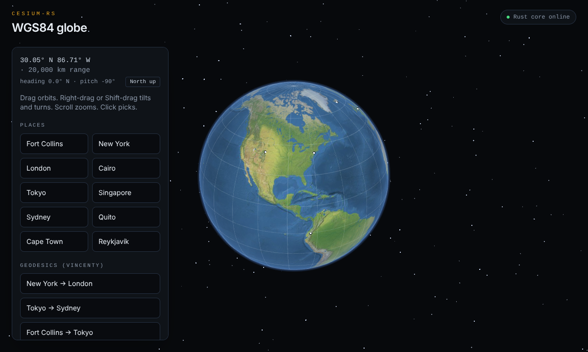

# CesiumRS

A 3D geospatial engine written in Rust for native applications and WebAssembly.

CesiumRS provides the full `@cesium/engine` geospatial stack — ellipsoidal math and geodesy, procedural 3D geometry, terrain and imagery tiling, 3D Tiles, glTF/Gaussian splat/voxel rendering, a WebGL1/WebGL2 renderer abstraction, a GLSL shader library, portable worker codecs, and time-dynamic geospatial data sources — implemented directly in Rust with no JavaScript runtime dependency.



## Capabilities

| Module | What it provides |
| --- | --- |
| `core` | Ellipsoids (WGS84, Moon, Mars, unit sphere), vectors, matrices, quaternions, local ENU/NED frames, geographic & Web Mercator projections, Vincenty geodesics & rhumb lines, splines & polynomial interpolation, spatial indices (`MortonOrder`, `HilbertOrder`, `S2Cell`), frustums & bounding volumes, procedural surface/volume geometries & `GeometryPipeline` (`earcut` triangulation, antimeridian splitting, vertex packing), tiling schemes, heightmap & quantized-mesh terrain tessellation/picking/providers (ArcGIS, Cesium, Google Earth Enterprise, VR-TheWorld, 3D Tiles terrain), astronomy & time (`JulianDate` with leap seconds, `Clock`, `Simon1994PlanetaryPositions`, IAU 2006 Earth orientation), async resource scheduling, and Cesium Ion / Google Maps / iTwin clients. |
| `scene` | 3D, 2D, and Columbus View scene runtime: frame loop, `Camera` & timed flights, `ScreenSpaceCameraController`, `Globe` & multi-layer imagery reprojection, `Cesium3DTileset` (explicit & implicit 3D Tiles 1.0/1.1, B3DM/I3DM/PNTS/glTF, 3D Metadata, styling expressions, clipping planes), glTF 2.0 `Model` pipeline (PBR, skinning, morphs, animations, Draco, Meshopt, SPZ Gaussian splats), point clouds with EDL, voxels, I3S Building Scene Layers, primitives, billboards, labels, polylines, particles, shadows, atmosphere, fog, post-processing, order-independent translucency (OIT), ground classification, and GPU/CPU picking. |
| `data_sources` | Time-dynamic entity model (`Entity`, `EntityCollection`, `CompositeEntityCollection`), sampled/callback/interval/composite properties, graphics visualizers, clustering, camera tracking, loaders for **CZML**, **KML/KMZ**, **GeoJSON/TopoJSON**, and **GPX**, and **KML/KMZ** export. |
| `renderer` | Typed WebGL1/WebGL2 rendering layer (`Context<G: Gl>`) with buffers, vertex arrays, 2D/cube/3D textures, texture atlases, framebuffers & MSAA, fullscreen compute commands, shader building & caching, interned render states, automatic uniforms, and async GPU picking/fences. Includes a browser WebGL backend; native hosts implement the `Gl` trait. |
| `shaders` | Complete registry of 307 GLSL shader modules (`shaders::shader(id)` and `shaders::builtin::czm_builtins()`) covering builtins, appearances, materials, models, post-process stages, and voxels. |
| `workers` | Portable CPU-heavy tasks runnable on native worker threads or WebAssembly workers: geometry generation & combination, terrain meshing, vector tiles, pure-Rust Draco (`draco-core`) and I3S decoding, KTX2/Basis Universal transcoding (`basisu`), LERC decompression, and Gaussian splat sorting. |
| `camera`, `geodesic`, `mesh`, `sun`, `api` | Lightweight high-level helpers and a raw WebAssembly C ABI built on `core` for standalone globe viewers. |

## Getting started

CesiumRS requires **Rust 1.97+**. The crate is not yet published to crates.io (`publish = false`) while the public API continues to settle; add it as a git dependency:

```toml
[dependencies]
cesium-rs = { git = "https://github.com/mtdewwolf/CesiumRS" }
```

### Feature flags

| Feature | Target | Description |
| --- | --- | --- |
| *(default)* | Native & Wasm | All portable algorithms: `core`, `scene`, `data_sources`, `renderer`, `shaders`, `workers`, and pure-Rust decoders (Draco, Basis/KTX2, LERC, Meshopt, SPZ). |
| `native-host` | Native | Blocking HTTP transport (`ureq`), async timers, and cooperative background worker threads (`NativeTransport`, `NativeTimer`, `NativeTaskWorker`). |
| `browser` | `wasm32` | `wasm-bindgen` bindings and browser adapters for HTTP/JSONP, canvas/image decoding, DOMPurify credits, video sync, WebGL1/WebGL2, and module workers. |
| `bundled-xys` | Native & Wasm | Compiles Cesium's IAU 2006 XYS Earth orientation tables (~1.8 MB) into `Iau2006XysData::bundled()`. |

### Quick examples

Compute a Vincenty geodesic on WGS84:

```rust
use cesium_rs::core::math::to_degrees;
use cesium_rs::core::{Cartographic, Ellipsoid, EllipsoidGeodesic};

let ellipsoid = Ellipsoid::WGS84;
let new_york = Cartographic::from_degrees(-74.006, 40.7128, 0.0);
let london = Cartographic::from_degrees(-0.1276, 51.5074, 0.0);

let route = EllipsoidGeodesic::new(&new_york, &london, &ellipsoid).unwrap();
let midpoint = route.interpolate_using_fraction(0.5);
println!(
    "Distance: {:.1} km (midpoint: {:.3}°, {:.3}°)",
    route.surface_distance / 1000.0,
    to_degrees(midpoint.latitude),
    to_degrees(midpoint.longitude),
);
```

Evaluate time-varying properties:

```rust
use cesium_rs::core::JulianDate;
use cesium_rs::data_sources::{Property, SampledProperty};

let epoch = JulianDate::from_iso8601("2026-01-01T00:00:00Z").unwrap();
let altitude = SampledProperty::<f64>::new(None);
altitude
    .add_samples(&[epoch, epoch.add_seconds(10.0)], &[100.0, 200.0], None)
    .unwrap();

assert_eq!(
    altitude.get_value(Some(&epoch.add_seconds(5.0)), None).unwrap(),
    Some(150.0)
);
```

### Browser / WebAssembly package

Build the `wasm-bindgen` browser bundle (`target/browser-core`):

```bash
cargo install wasm-bindgen-cli --version 0.2.129 --locked
scripts/build-browser-core.sh
```

```javascript
import init, { BrowserCore } from "./cesium_rs.js";

await init();
const core = new BrowserCore();
const data = await core.fetchJson("/data.json");
const image = await core.fetchImage("/image.png", false, false);
```

See [Core host adapters](docs/core-hosts.md) for the full native and browser integration API, including text/pin rendering, screen-space input, and video synchronization.

## Architecture & design notes

- **Pure-Rust codecs, zero C++ toolchain required.** Draco (`draco-core`), Basis Universal/KTX2 (`basisu`), LERC (`lerc-reader`), Meshopt (`meshopt-rs`), and SPZ Gaussian splat decoding all compile cleanly to both native targets and `wasm32-unknown-unknown`.
- **Explicit host boundaries.** Network I/O (`ResourceClient`), GPU execution (`renderer::Gl`), canvas/image decoding (`CanvasHost` / `ImageHost`), and worker scheduling are injected rather than hidden behind browser globals, allowing the same engine code to run headlessly on servers, in native apps, or in browsers.
- **Explicit ownership and threading.** GPU handles, caches, and scene graphs use context-local `Rc` ownership with deterministic `destroy()` and drop cleanup. Process-wide leap seconds live behind an `RwLock`; PRNG state and terrain index caches are per-thread; async render requests and terrain error events are `Send`.
- **Cross-platform deterministic math.** `core::js_math` implements deterministic transcendental functions across native and WebAssembly targets so geometric algorithms and bounding volumes produce consistent results everywhere.
- **Idiomatic error and absence handling.** Operations that can fail return `Result`, missing or degenerate results return `Option`, and enum parameters are strongly typed at compile time.

## Interactive globe viewer

[`web/`](web/README.md) is a [Lakebed](https://lakebed.dev) WebGL globe viewer powered by CesiumRS compiled to WebAssembly. It renders a WGS84 globe with Natural Earth II imagery, place presets, Vincenty geodesic routing (with a deterministic great-circle fallback for near-antipodal pairs), tap-to-measure, ray picking, graticule, geographic and Web Mercator tile grids, and solar lighting.

A live build is hosted at https://frosted-ridge-959d00d06e.lakebed.app.

```bash
scripts/build-web.sh          # compile wasm32-unknown-unknown and update web/client/generated
scripts/check-generated.sh    # verify web/client/generated matches a fresh build
node scripts/check-web.mjs    # exercise the bundled wasm API
cd web && npx lakebed dev     # run locally at http://localhost:3000
```

## Examples, testing & benchmarks

Run the included Rust examples:

```bash
cargo run --example geodesic_route
cargo run --example camera_and_picking
cargo run --profile bench --example benchmark
```

> **Note on build profiles:** `[profile.release]` is size-tuned (`opt-level = "s"`, LTO, `panic = "abort"`) for the WebAssembly viewer bundle. Use `--profile bench` (`opt-level = 3`) for native throughput measurements.

Run the test and validation suites:

```bash
cargo test --all-features              # unit, integration, and native-host tests
bash scripts/check-browser-core.sh     # build and test the Core browser WASM bundle in Chromium
bash scripts/check-renderer.sh         # WebGL2 renderer checks in headless Chromium
bash scripts/check-scene.sh            # Scene GPU checks in headless Chromium
```

Run the cross-runtime benchmark suite (comparing native Rust, Wasm, Node, and Chromium on identical geospatial workloads):

```bash
scripts/bench.sh                       # full suite -> target/bench-results/report.md
scripts/bench.sh --quick               # fast smoke run
```

## Documentation

- [Core host adapters](docs/core-hosts.md) — native HTTP/timers/workers, browser WASM bindings, terrain sampling, canvas/input hosts.
- [Scene](docs/scene.md) — frame loop, camera, 3D Tiles, glTF models, picking, atmosphere, voxels, and rendering pipeline.
- [DataSources](docs/data-sources.md) — entity system, time-varying properties, document loaders, and visualizers.
- [Renderer](docs/renderer-foundation.md) — `Gl` trait, GPU resource lifetimes, framebuffers, shader builder, and automatic uniforms.
- [Workers](docs/workers.md) — geometry, terrain, vector-tile, Draco, I3S, KTX2, and Gaussian splat workers.
- [Shaders](docs/shaders.md) — GLSL shader registry layout and lookup API.
- [Benchmarks](docs/benchmarks.md) — workload definitions, methodology, and runtime setups.
- [Changelog](CHANGELOG.md) & [Module inventory](PORTING.md) — release history and full CesiumJS `@cesium/engine` 23.0.0 module map.

## License

Licensed under the [Apache License, Version 2.0](LICENSE). See [NOTICE](NOTICE) for third-party attributions.

Algorithms and API architecture follow [CesiumJS](https://github.com/CesiumGS/cesium) (Apache-2.0). This project is not affiliated with Cesium GS, Inc.
