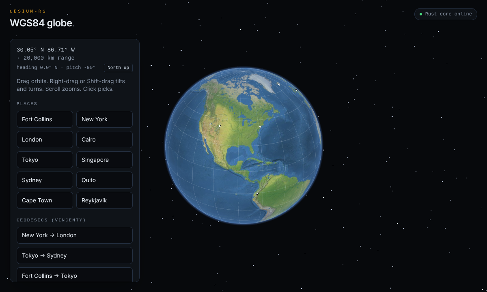

# CesiumRS

A port of **CesiumJS** (`@cesium/engine` 23.0.0, CesiumJS 1.139) to Rust. It is a rewrite, not a binding to the JavaScript library, and each ported module is checked against real CesiumJS output.


**Status: 15.0% of CesiumJS ported** (179 fully ported and 1 partial of 1,266 applicable modules, weighted by JavaScript lines). **Core, the math, geometry and time foundation, is at 58.3%, on the way to a 75% milestone** (about 16,400 more lines). [PORTING.md](PORTING.md) lists every module with its status, and its [Plan](PORTING.md#plan) section lists the batches to 75% Core.

## What is ported

All of these live in `src/core`, one Rust module per Cesium module:

| Area | Cesium modules |
| --- | --- |
| Math | `Math` (incl. `MersenneTwister` random numbers), `Cartesian2/3/4`, `Matrix2/3/4`, `Quaternion`, `HeadingPitchRoll`, `HeadingPitchRange`, `Spherical`, `Cartographic`, `TranslationRotationScale`, `Color` (CSS parsing, named colors) |
| Ellipsoid and projections | `Ellipsoid` (WGS84, Moon, Mars, unit sphere), `scaleToGeodeticSurface`, `Rectangle`, `GeographicProjection`, `WebMercatorProjection`, `MapProjection`, `EllipsoidTangentPlane` |
| Curves | `EllipsoidGeodesic` (Vincenty), `EllipsoidRhumbLine` |
| Animation and interpolation | `Spline` (shared trait and time operations), `ConstantSpline`, `LinearSpline`, `SteppedSpline`, `QuaternionSpline`, `MorphWeightSpline`, `HermiteSpline` (incl. natural and clamped cubics), `CatmullRomSpline`, `TridiagonalSystemSolver`, `EasingFunction`, `LagrangePolynomialApproximation`, `LinearApproximation`, `HermitePolynomialApproximation` |
| Intersections | `Ray`, `Plane`, `IntersectionTests`, `Intersect`, `Interval`, `QuadraticRealPolynomial`, `CubicRealPolynomial`, `QuarticRealPolynomial` |
| Spatial ordering | `MortonOrder` (2D/3D Z-order encode/decode), `HilbertOrder` (2D encode/decode through level 32; higher levels remain unported) |
| Vertex packing | `AttributeCompression` (oct normals, texture coordinates, ZigZag terrain decoding, dequantization, RGB), `EncodedCartesian3` (high/low position splitting) |
| Bounding volumes and culling | `BoundingSphere`, `BoundingRectangle`, `AxisAlignedBoundingBox`, `OrientedBoundingBox`, `CullingVolume`, `Occluder`, `EllipsoidalOccluder`, `Visibility` |
| Frustums | `PerspectiveFrustum`, `PerspectiveOffCenterFrustum`, `OrthographicFrustum`, `OrthographicOffCenterFrustum` |
| Enums and helpers | `ArcType`, `CornerType`, `ReferenceFrame`, `isBitSet`, `NearFarScalar`, `DistanceDisplayCondition`, `WebGLConstants` |
| Tiling | `TilingScheme` (trait), `GeographicTilingScheme`, `WebMercatorTilingScheme`, `Stereographic` |
| Mesh data | `ComponentDatatype`, `IndexDatatype`, `PrimitiveType` (typed arrays as one `TypedArray` enum), `Tipsify`, `WireframeIndexGenerator`, `Intersections2D` |
| Geometries | `Geometry`, `GeometryAttribute(s)`, `GeometryType`, `GeometryOffsetAttribute`, `VertexFormat`; `BoxGeometry`, `PlaneGeometry`, `EllipsoidGeometry`, `SphereGeometry`, `CylinderGeometry`, `FrustumGeometry` and their outlines; `EllipseOutlineGeometry`, `CircleOutlineGeometry`, `EllipseGeometryLibrary`. Full vertex and index buffers are compared with CesiumJS. |
| Polygons | `PolygonPipeline` (area, winding order, triangulation, chord and rhumb-line subdivision, geodetic height scaling) on `earcut`, a line-for-line port of earcut 3.2.4 whose triangle order matches the JavaScript library |
| Geometry instances and pipeline | `GeometryInstance`, `GeometryInstanceAttribute`, `ColorGeometryInstanceAttribute`, `ShowGeometryInstanceAttribute`, `OffsetGeometryInstanceAttribute`, `DistanceDisplayConditionGeometryInstanceAttribute`; `GeometryPipeline` (wireframes, vertex-cache reordering, 16-bit index splitting, 2D projection, high/low encoding, world transforms, combining instances, normals and tangents, vertex compression, and splitting triangles, lines and polylines at the antimeridian) |
| Utilities | `Heap`, `DoubleEndedPriorityQueue`, `Queue`, `DoublyLinkedList`, `mergeSort`, associative and managed arrays, typed-array strings, URI parsing and helpers, query strings, GUIDs, `PixelFormat`, `PixelDatatype`, and Core's enums |
| Frames | `Transforms`: local frames, heading-pitch-roll, window coordinates, 2D model matrices, and the time-dependent TEME, ICRF and Moon-fixed frames |
| Time | `JulianDate` (with Cesium's runtime-extendable leap-second table), `GregorianDate`, `LeapSecond`, `Iso8601`, `TimeInterval`, `TimeIntervalCollection`, `TimeStandard`, `TimeConstants`, `Clock`, `ClockStep`, `ClockRange`, `Event` |
| Astronomy and Earth orientation | `Simon1994PlanetaryPositions` (Sun and Moon positions), `EarthOrientationParameters`, `Iau2006XysData` (Cesium's XYS tables are in `assets/IAU2006_XYS`; the `bundled-xys` feature compiles them in), `Iau2000Orientation`, `IauOrientationAxes`, `IauOrientationParameters` |

### Mapping CesiumJS to Rust

- `result` out-parameters become return values.
- Where Cesium returns `undefined`, Rust returns `Option`. Where Cesium throws a `RuntimeError` or rejects bad input (such as an invalid ISO 8601 string), Rust returns `Result`.
- Checks that only exist in Cesium's debug builds (`DeveloperError`) are not ported. Rust behaves like Cesium's release build, except where the check prevents a crash or an endless loop; those cases return `Option`.
- Cesium's quirks are kept on purpose and documented where they occur. For example, `Date.UTC` maps years 0–99 to 1900–1999, `fastSlerp` rounds to `Float32Array`, and the cubic root solver has a known bug.
- Quantized component types are native Rust integer slices. Dequantized attributes and RGB565 colors return `Vec<f32>` to preserve `Float32Array` rounding. Buffer writes return `None` on invalid lengths or offsets without modifying the buffer.
- `HilbertOrder` preserves Cesium's large-index Number rounding and signed bitwise behavior; at high levels its encode/decode pair does not always round-trip. Its supported level range is currently 1–32.
- Where Cesium builds attributes or indices in plain JavaScript arrays (such as `PolygonPipeline`'s subdivisions), Rust stores the values as `Float64` and the indices as `Uint32`, so no precision is lost.
- Spline constructors check data shape and finite, strictly increasing times. Import the `Spline` trait for evaluation and time operations. Point types are checked at compile time; scalar and Cartesian3 values support linear interpolation, and quaternion animation uses `QuaternionSpline`.

## How parity is checked

`tools/cesium` installs the real `@cesium/engine` 23.0.0. Node scripts call it with seeded random inputs and edge cases and save the inputs and outputs as JSON in `tests/fixtures`. The `tests/core_*.rs` suites replay all **21,181 cases** through the Rust port and compare the results within a relative and absolute tolerance of 1e-12. Hilbert indices use decimal strings to preserve BigInt precision in JSON. A fixture function that has no Rust counterpart fails the test, so nothing is skipped by accident.

```bash
cargo test                                   # unit tests + all CesiumJS fixtures
cd tools/cesium && npm ci && npm run fixtures   # regenerate fixtures from CesiumJS
npm run tracker                              # rebuild PORTING.md and the charts
npm run milestone -- "Name"                  # same, starting a new point on the history chart
```

The tracker reads module status from `tools/cesium/status.json` and the hand-written plan from `tools/cesium/plan.md`.

For a focused fixture refresh, pass module names, for example
`bun run fixtures LinearSpline QuaternionSpline` from `tools/cesium`.
This leaves other fixture files untouched.

## Viewer



`web/` is a [Lakebed](https://lakebed.dev) capsule that draws a WGS84 globe with WebGL. It runs on the wasm build of this crate and provides places, Vincenty geodesics, tap-to-measure, picking, a graticule, geographic and Web Mercator tile grids, and sun lighting. The imagery is Natural Earth II, the same set CesiumJS bundles. A live build is at https://frosted-ridge-959d00d06e.lakebed.app.

```bash
scripts/build-web.sh          # cargo build --target wasm32-unknown-unknown, embedded into web/
cd web && npx lakebed dev
```

The viewer still uses the first-generation modules in `src/` (`camera`, `ellipsoid`, `geodesic`, `intersect`, `projection`, `mesh`, `sun`). Moving it onto `src/core` is on the roadmap.

## Roadmap

1. **Core geometry:** filled ellipses and circles, rectangles, polygons, polylines, corridors and walls, now that `GeometryPipeline` and `PolygonPipeline` are in, plus terrain.
2. **Core algorithms:** Hilbert levels above 32.
3. **Moving the viewer onto `src/core`,** then redeploying it.
4. **Renderer, Scene, DataSources, Workers and Shaders,** the rest of the way to 100%.

## License

Apache-2.0. The algorithms follow CesiumJS ([Apache-2.0](https://github.com/CesiumGS/cesium)). This project is not affiliated with Cesium GS, Inc.
